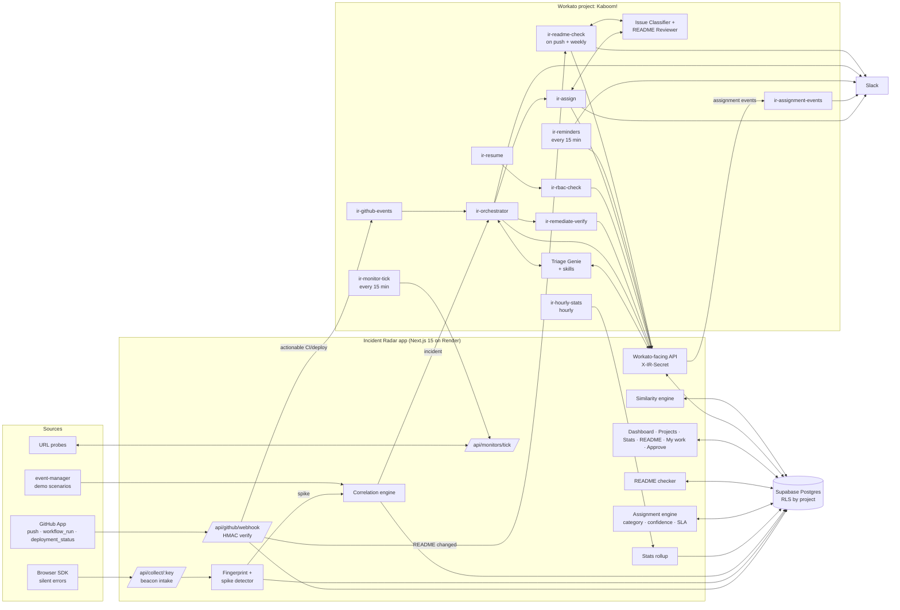

# Incident Radar v2: Plan of Action

**PRD · TRD · Master Prompts · Phase-wise Build Steps**

| | |
|---|---|
| Project | Incident Radar, Workato Hack: Agentic India (Track 1: Enterprise Agentic Workflows) |
| Repo | https://github.com/bachi-2006/Incident-Radar |
| Workato project | `Kaboom!` (Project 18200516, Folder 35715801) |
| Web build lane | **Antigravity** (Next.js app, Supabase schema, SDK, tests, UI) |
| Workato build lane | **AIRO MCP** (build and edit recipes, Genie, skills) + **Workato CLI** (pull, push, validate, version control) |
| Status | Draft v2, 10 Oct 2026 (revised: expertise-based assignment in Slack with deadlines and reminders; Report = README compliance) |

---

## 0. How to use this document

This is the single source of truth for the v2 build. It has four parts that build on each other.

1. **Sections 1–3** say what is being built and why, and what the repo looks like today.
2. **Section 4 (PRD)** is the product contract: users, requirements and acceptance criteria.
3. **Section 5 (TRD)** is the engineering contract: data model, APIs, Workato recipes, algorithms and security.
4. **Sections 6–8** are the execution kit: tool setup, the two master prompts, and step-by-step phases. Each phase has a ready-to-paste prompt for Antigravity and for AIRO MCP, the CLI commands, and a test that proves the phase is done.

Two lanes work in parallel, and they only meet at the **API contract** (Section 5.4). That contract also lives in the repo as `docs/contracts/workato-api.md`. Neither lane changes it without updating that file first.

> **About the tool commands.** Workato CLI command names and Antigravity menu names below come from public documentation as of mid-2026 and may differ in your installed version. Run `workato --help` and check Antigravity's settings before scripting anything. The steps are written so that the *intent* is clear even if a flag name differs.

---

## 1. Feature brief (from the handwritten notes)

### 1.1 What the notes say

The notes show an organisation (**XYZ**) at the top with one node (**1**) fanning out into many branches. This reads as one workspace that owns many projects or websites, each monitored on its own. The left margin lists the existing pipeline stages, and the right side lists the new features. F2 and F4 below follow your clarification.

| # | Note (as written) | Meaning | Feature ID |
|---|---|---|---|
| — | XYZ → 1 → many branches | One **organisation workspace** that owns many **projects** (sites/services), each with its own repos, monitors, owners and incidents | F0 Multi-project workspace |
| 1 | "Website (CI/CD) monitoring like hourly stats" | Monitor each website's uptime and latency plus its CI/CD pipeline (builds, deploys), rolled up into **hourly stats** | F1 Website + CI/CD monitoring |
| 2 | "Report" | The project's **README**. Every README must clearly state the **Problem** and the **Solution**. If either is missing or wrong, the person who owns the project is **pinged in Slack** with the exact changes needed, and reminded until it's fixed. | F2 README compliance |
| 3 | "First GitHub-like workspace access" | **Sign in with GitHub** and get a GitHub-style workspace: org → projects → repos, with members invited into it | F3 GitHub-style workspace access |
| 4 | "And it should also role based project assignment" | **Expertise-based assignment in Slack.** Each issue is classified by type (System Architecture, Frontend, Backend, Database, DevOps, Security). A **confidence score** is calculated for the best person for that type, and the project and issue are assigned to them in Slack with a **deadline** and **timely reminders**. | F4 Smart assignment + deadlines |
| 5 | "Should show similarity score from previous commits" | A **similarity score** that compares the current failure (and each new commit) with previous commits, so the likely culprit commit is ranked | F5 Commit similarity score |
| 6 | "Also should be able to identify errors which aren't in console" | Detect **silent errors**: failures that never show as a console error (swallowed exceptions, failed requests handled quietly, 200-with-error responses, broken assets, blank UI, dead clicks) | F6 Silent error detection |

Left margin (existing pipeline, kept as the backbone): **Observe → Correlate → Investigate → Decide → Authorize → Act → Verify → Communicate → Audit**, on **App + Supabase (Postgres)**, with accounts and secrets.

> **Your own README fails F2 today.** The repo's README has no "Problem" or "Solution" heading (the content sits under "Executive Summary"). That makes a strong live demo: run the check on your own repo, get pinged in Slack with the changes, fix the README, and watch the re-check pass.

### 1.2 How the new features plug into the pipeline

| Pipeline stage | Today | v2 adds |
|---|---|---|
| Observe | Synthetic events from `event-manager` | GitHub CI/CD events (F1), uptime probes (F1), browser SDK silent errors (F6), README changes (F2) |
| Correlate | `corelation-engine` clusters events | Deploy markers and silent-error spikes as correlation signals |
| Investigate | Triage Genie | Genie gets new skills: suspect commits with similarity scores (F5), project health (F1), silent errors (F6). A new **Issue Classifier** labels the issue type (F4). |
| Decide | `/api/policy/decide` | Policy uses commit similarity as evidence for rollback (F5) |
| Authorize | Slack approval link | Approval only counts if the approver holds the right access role on the project |
| Act | `/api/actions/execute` | Rollback targets the *specific* suspect commit's deploy |
| Verify | Simulated 3 healthy samples | **Real** samples from uptime probes and live error rates |
| Communicate | Slack channel post | Issue **assigned to the best-fit specialist** with a confidence score, deadline and reminders, then escalated if overdue (F4) |
| Audit | SHA-256 receipt | Receipts stored per project. Assignment history (on time or late) feeds future confidence scores. README check history kept per project (F2). |

---

## 2. Current-state audit of the repo

This audit was done by reading the code, not just the README. It decides what Phase 0 has to fix before new features go on top.

### 2.1 What exists and works

- **Next.js 15 App Router** app (`src/app`) with pages for dashboard, incidents, events, services and simulation. Uses Tailwind 4, Recharts and lucide-react.
- **Supabase schema** (`supabase/schema.sql`) with `incidents`, `events`, `event_relationships`, `services` and an `upsert_incident_bundle` RPC.
- **Correlation engine** (`corelation-engine/`) with weighted time, service, dependency, semantic and sequence scores and clustering. Its `normalizeText` and semantic scoring can be reused for F5.
- **Event manager** (`event-manager/`) with scenario generators for database failure, payment degradation and memory leak.
- **Workato-facing API routes** guarded by `X-IR-Secret`: `/api/agent/events`, `/api/policy/decide`, `/api/actions/execute`, `/api/verify`, `/api/runs/[id]/finalize`, `/api/ingest`, `/api/orchestrator/trigger`.
- **Workato assets:** `ir-orchestrator`, `ir-remediate-verify`, `ir-resume`, Triage Analyst Genie + Skill, HTTP and Slack connections.
- **Lyzr integration** (`src/lib/lyzr.ts`) for postmortem, re-verify and chat.
- AIRO MCP is already configured for Cursor in `.cursor/mcp.json` (`https://app.workato.com/airo_mcp`).
- Deployed on **Render free tier** (`render.yaml`).

### 2.2 Gaps found (must fix in Phase 0)

| # | Gap | Where | Why it matters for v2 |
|---|---|---|---|
| G1 | `/api/runs/[id]/resume` is in the README but **the route does not exist**. Only `finalize` exists under `runs/[id]`. | `src/app/api/runs/[id]/` | The ASK path cannot complete for real. F4's role-checked approvals depend on it. |
| G2 | There is **no `/approve/[runId]` page**, but the policy's Slack text links to one. | `policy/decide/route.ts` | The approval link in Slack opens a 404. |
| G3 | **Verification is simulated.** It returns "recovered" after 2 polls, whatever the real state. | `api/verify/route.ts` | This breaks the core promise ("never claim recovery without fresh telemetry"). F1 probes give the real data to fix it. |
| G4 | **Run state is in memory** (`global.activeRunState`, `pollCounts` Map). | `lib/run-state.ts`, `verify` | Lost on every Render restart or spin-down (free tier sleeps after ~15 min idle). It cannot be scoped per project. |
| G5 | **The policy chooses its path from `run_id` substrings** ("notify", "ask", "memory"). | `policy/decide/route.ts` | Fine for a demo, but real incidents must be decided from the Genie's assessment only. Keep the substring logic behind a `DEMO_MODE` flag. |
| G6 | **RLS is wide open:** `for all using (true) with check (true)` on every table. | `supabase/schema.sql` | RBAC (F4) is meaningless until the policies check membership. |
| G7 | There is **no auth and no user model**, and no `project_id` on any table. | schema, app | F0, F3 and F4 all need these. |
| G8 | Two LLM stacks: the Workato Genie (triage) and Lyzr (postmortem, chat). | `lib/lyzr.ts` | Issue classification (F4) and README review (F2) should run as Workato Genies to strengthen the Workato story. Decision in Open Questions. |

---

## 3. Plan at a glance

### 3.1 Lanes

| Lane | Tool | Owns |
|---|---|---|
| **A: Web** | Antigravity (agent IDE, with its browser agent for UI checks) | Next.js pages and API routes, Supabase migrations and RLS, GitHub App webhook receiver, browser SDK, similarity engine, stats rollups, tests, Render deploy |
| **B: Workato** | AIRO MCP (build/edit via natural language) + Workato CLI (pull/push/validate, git history) | Recipes, recipe functions, schedulers, webhooks, Genie + skills, connections, project properties, Slack messaging |
| **Contract** | `docs/contracts/workato-api.md` | Every endpoint Workato calls, with request and response JSON. Both lanes read it, and changes go through it. |

**Rule of thumb for what goes where.** High-volume work and every score stay in the app, where they can be unit-tested: SDK beacons, GitHub webhook verification, commit similarity, assignment confidence, deadlines, reminder schedules, README structural checks, rollups. **Sequencing, Genie reasoning, people and messaging** go to Workato: schedules, triage, issue classification, README review, policy calls, approvals, assignment and reminder delivery, Slack. This keeps Workato task usage low and keeps Workato as the orchestrating brain.

### 3.2 Phases

| Phase | Name | Features | Lane A (Antigravity) | Lane B (Workato) |
|---|---|---|---|---|
| 0 | Foundation and hardening | G1–G6 | Persist runs, add resume route and approve page, `DEMO_MODE`, migrations framework, contract file | Set up CLI and MCP, pull `Kaboom!` into git, wire `ir-resume` to the real route |
| 1A | Workspaces, GitHub login, access roles, expertise profiles | F0, F3, F4 setup | Orgs, projects, members, GitHub OAuth, RLS, profile with skills, timezone and Slack link | `ir-rbac-check`, role-checked `ir-resume`, Slack ID auto-link by email |
| 1B | Smart assignment, deadlines, reminders | F4 | Issue classification rules, assignment confidence engine, SLA deadlines, reminder schedule, assignment action page | Issue Classifier Genie, `ir-assign`, `ir-assignment-events`, `ir-reminders`, `ir-project-ownership` |
| 2 | GitHub + CI/CD ingestion | F1 (CI/CD), F3 | GitHub App, webhook receiver, commits/CI runs/deploys, CODEOWNERS; adds **file ownership** to the assignment score | `ir-github-events` (CI failure or bad deploy → orchestrator) |
| 3 | Website monitoring + hourly stats | F1 | Monitors, probe runner, `hourly_stats` rollup, stats dashboard | `ir-monitor-tick` (every 15 min), `ir-hourly-stats` (hourly) |
| 4 | Silent error detection | F6 | Browser SDK, `/api/collect`, fingerprinting, spike detector, UI | Genie skill `get_silent_errors`, orchestrator branch for client-side incidents |
| 5 | Commit similarity score | F5 | Similarity engine, suspect-commit API, commit risk on push, UI | Genie skill `get_suspect_commits`, policy rule update in orchestrator |
| 6 | README compliance | F2 | Structural README checker, repo-facts extractor, README page and history | README Reviewer Genie, `ir-readme-check` (on push + weekly), Slack pings with change requests through the assignment and reminder engine |
| 7 | Real verification + end-to-end | G3 | `/api/verify` reads live probes and errors | Update `ir-remediate-verify` loop, full E2E runs, demo rehearsal |

### 3.3 Hackathon cut (10–11 Oct 2026)

The full plan is more than one hackathon's work. This order puts your two clarified features first, because they are the most visible in a demo. The hours are rough estimates for one person per lane working with agents.

| Priority | Ship in hackathon | Hours (A / B) | Can be faked for demo? |
|---|---|---|---|
| 1 | Phase 0: resume route, approve page, persisted runs | 2 / 1 | No. The ASK path must really work. |
| 2 | Phase 1A (lite): GitHub login, 1 org, 2 projects, access roles, expertise on the profile page | 3 / 0.5 | Seed 4–5 members with skills instead of inviting them |
| 3 | Phase 1B: classification, confidence-scored assignment in Slack, deadlines, reminders | 4 / 2.5 | Use `SLA_TIME_SCALE=60` so a 4-hour deadline plays out in 4 minutes on stage |
| 4 | Phase 6: README check on your own repo, Slack ping, fix, re-check | 3 / 1.5 | No. It works on the real repo. |
| 5 | Phase 5 (deterministic score only): suspect commits ranked and fed to the Genie | 3 / 1 | Seed commit history from the real repo with the GitHub API |
| 6 | Phase 4 (SDK core): failed fetch, soft errors, resource 404s, dead clicks | 3 / 1 | Use the demo checkout page as the monitored site |
| 7 | Phase 3: probes + hourly stats chart | 3 / 1 | Backfill 24 h of stats so the chart isn't empty |
| 8 | Phase 2: CI/CD webhooks + file ownership | 2 / 1 | Replay saved webhook payloads |
| 9 | Phase 7: real verify | 2 / 1 | No. It is the core safety claim. Do it before demo time. |

Total is roughly **25 h (A)** and **10.5 h (B)**. That is tight for two days, so if time runs short, cut priorities 7 and 8 first. Never cut 1, 3, 4 or 9.

---

## 4. PRD

### 4.1 Problem statement

Engineering teams in one organisation run many websites and services, and each has its own repos, pipelines and specialists. Today Incident Radar can triage and safely fix one incident at a time, but it doesn't know **which project** an incident belongs to, **what kind of problem** it is, **who is the right specialist** to own it, or **which commit** probably caused it. It can't see failures that **never reach a console or log**, and nobody chases an assignee when a deadline slips. Separately, project READMEs often don't say what problem the project solves or how, which makes onboarding, judging and handovers slow.

### 4.2 Goals

| # | Goal | Measure | Target |
|---|---|---|---|
| G-1 | Right specialist, first time | Issues whose first assignee accepts and resolves them (no reassignment) | ≥ 80% on the seeded scenario set |
| G-2 | Deadlines are met | Assignments acknowledged before the ack deadline / resolved before the due date | ≥ 90% ack on time; overdue items always escalated (100%) |
| G-3 | Every README explains problem and solution | Projects with a passing README check | 100% of active projects within 3 days of a failed check |
| G-4 | Find the culprit commit fast | Incidents where the true culprit is in the top 3 suspect commits | ≥ 80% across the demo scenarios and the seeded history |
| G-5 | Catch silent failures | Seeded silent-failure cases (6 types) detected and turned into an incident | 6/6 detected; incident opened ≤ 5 min after the spike |
| G-6 | Honest recovery | Incidents marked resolved only after 3 consecutive **real** healthy samples | 100%; zero simulated verdicts outside `DEMO_MODE` |

### 4.3 Non-goals (v2)

- **A replacement for Jira or Linear.** Assignments, deadlines and reminders cover incidents and README fixes only, not general task tracking. A general tracker is a different product, and a sync connector can come later.
- **A full APM or log platform.** Incident Radar ingests the signals it needs and doesn't replace Datadog or Sentry.
- **Writing or rewriting READMEs automatically.** The check says exactly what to change, and a person makes the change. That keeps the owner accountable for what the README claims.
- **Automatic code fixes or reverts pushed to main.** Rollback means redeploying the previous good build through the guarded gateway.
- **Session replay** in the SDK. It carries a high privacy cost and isn't needed to detect silent errors.
- **GitLab and Bitbucket.** GitHub only for v2. The data model keeps a `provider` column so others can be added.

### 4.4 Personas

| Persona | Description |
|---|---|
| **Org owner / admin** (e.g. XYZ's platform lead) | Creates the workspace, connects GitHub, creates projects, confirms project owners |
| **Project lead / maintainer** | Owns a project and its README, confirms low-confidence assignments, approves deadline extensions and high-risk fixes |
| **Specialist engineer** (System Architecture, Frontend, Backend, Database, DevOps, Security) | Gets assigned issues that match their expertise, acknowledges them, works to a deadline |
| **Viewer** (manager, auditor, judge) | Reads dashboards, stats, assignments and README status. Can't act. |
| **Workato orchestrator** (system actor) | Classifies, assigns, reminds and escalates through Slack. Calls the API with the shared secret, scoped per project. |

### 4.5 User stories

**Workspace and access (F0, F3)**
- As an org owner, I want to sign in with GitHub and create a workspace for my company so that my team uses the identities they already have.
- As an org owner, I want to import repositories from our GitHub organisation as projects so that I don't have to configure each one by hand.
- As an engineer, I want to list my expertise (for example Frontend 5, Backend 3) and working hours on my profile so that I'm assigned work I'm good at, at times I'm working.

**Smart assignment, deadlines and reminders (F4)**
- As a project lead, I want each new issue classified by type (System Architecture, Frontend, Backend, Database, DevOps, Security) with a confidence score so that I know how sure the system is.
- As a project lead, I want the issue assigned in Slack to the person with the highest confidence score for that type so that the right specialist starts immediately.
- As an assignee, I want the Slack message to tell me *why* I was picked (skill, files I own, past fixes, availability), the deadline, and one-tap actions (Acknowledge, Decline, Request extension) so that I can respond in seconds.
- As an assignee, I want reminders before the deadline (not after it's already missed), and none outside my working hours unless it's critical, so that reminders help rather than nag.
- As a project lead, I want to be asked to confirm when the confidence score is middling, and to pick from the top 3 candidates when it's low, so that the system never silently guesses.
- As a project lead, I want overdue items escalated to me with a one-tap "Reassign to next best" so that nothing stalls.
- As an org admin, I want each project's categories (its frontend, backend and so on) to have a suggested primary and backup owner with confidence scores that I confirm in Slack, so that projects themselves are assigned to people.
- *Edge case:* when an issue spans two types almost equally (for example Frontend and Backend), I want a primary assignee plus a collaborator from the second type.
- *Edge case:* when the best candidate is out of office or already overloaded, I want the next best person picked, with the reason shown.
- *Edge case:* as an access-role check, an approver without the required role on the project must get a clear "you're not authorised" message.

**README compliance (F2)**
- As a project lead, I want every README checked for a clear **Problem** and **Solution** whenever it changes, and weekly, so that the README always explains the project.
- As a project lead, I want a Slack message listing exactly what's wrong (missing heading, too vague, solution doesn't match the code) and a suggested fix for each, so that I know precisely what to change.
- As a project lead, I want a deadline and reminders for README fixes, and a "README approved" message when the re-check passes, so that I know when I'm done.
- As a viewer or judge, I want a README status badge and check history per project so that I can see compliance at a glance.
- *Edge case:* when the README hasn't changed since the last failed check, I don't want a duplicate ping, only the scheduled reminders.
- *Edge case:* when there's no README at all, I want that reported as a failure without spending a Genie call.

**Website and CI/CD monitoring (F1)**
- As a maintainer, I want to add a URL monitor with content checks so that I know when my site is down *or* serving an error page with status 200.
- As a maintainer, I want CI runs and deploys from GitHub on my project timeline so that I can see what changed before an incident.
- As a viewer, I want an hourly chart of uptime, latency, error rate, CI pass rate and deploys so that I can see trends.

**Commit similarity (F5)**
- As a responder, I want each incident to show recent commits ranked by a similarity score with a breakdown so that I can find the likely culprit in seconds.
- As a maintainer, I want each new commit scored against past incident-causing commits so that risky changes are flagged before they ship.

**Silent errors (F6)**
- As a maintainer, I want to add one script tag to my site to capture failures that never appear in the console so that silent breakages surface.
- *Edge case:* as a privacy-conscious owner, I want PII (emails, tokens, query strings) scrubbed before anything leaves the browser.

### 4.6 Requirements

#### P0: must ship

| ID | Requirement | Acceptance criteria |
|---|---|---|
| R-0.1 | Persisted runs + working resume and approve flow | Given an ASK run, when an authorised user approves on `/approve/:runId`, then `ir-resume` runs and the run completes. The run survives an app restart mid-approval. |
| R-0.2 | `DEMO_MODE` isolates simulated behaviour | With `DEMO_MODE=false`, `/api/policy/decide` ignores `run_id` substrings and `/api/verify` never returns a simulated verdict. |
| R-1.1 | GitHub sign-in | A user can sign in with GitHub through Supabase Auth. Their GitHub username and avatar are stored. |
| R-1.2 | Org → project → member model with access roles | Owners create orgs and projects and invite members. Access roles (viewer, responder, maintainer) control what people can do. A viewer of project A gets zero rows from project B on every table (automated two-user RLS test). |
| R-1.3 | Expertise profile + Slack link | Each member can set a 0–5 level for each issue category, a timezone, working hours and an out-of-office flag. Their Slack user is linked automatically by email (manual fallback). |
| R-1.4 | Issue classification with confidence | Every new incident gets a category, a secondary category, a probability per category, and a category confidence (0–1) combining rules and the Issue Classifier Genie (5.6.4). The rationale is stored and shown. |
| R-1.5 | Confidence-scored assignment | The system ranks eligible members by assignment confidence (0–100) with a breakdown. At **≥ 75** it assigns automatically. Between **55 and 75** the project lead confirms in Slack. **Below 55** the lead picks from the top 3 in the project channel. Nobody without Slack linked, out of office or without at least the responder role is assigned. |
| R-1.6 | Assignment message in Slack | The assignee's DM shows issue title, category, confidence score with the top 3 reasons, deadline in their timezone, and Acknowledge, Decline and Request extension links (signed, single-use). |
| R-1.7 | Deadlines from SLA policy | Each assignment gets an ack deadline and a due date from the project's SLA policy by severity (defaults in 5.6.5). Leads can change policy per project. |
| R-1.8 | Timely reminders and escalation | Reminders go out when the ack deadline passes, and at 50% and 80% of the time to the due date. At 100% the item is marked overdue and escalated to the lead with "Reassign to next best". No reminder kind is sent twice. Non-critical reminders wait for working hours. |
| R-1.9 | Project ownership assignment | When a repo is mapped to a project, the system proposes a primary and backup owner per category with confidence scores and DMs the admin to confirm. Confirmed owners get a bonus in future issue assignments. |
| R-1.10 | Role-checked approvals | An approval from a user without the run's required access role is rejected with a clear reason, logged, and posted to the Slack thread. Workato re-checks before acting. |
| R-2.1 | CI/CD ingestion | `workflow_run`, `deployment_status` and `push` webhooks are verified (HMAC) and stored. A failed run on the default branch or a failed deploy creates an event. Commit authorship and `CODEOWNERS` feed the ownership part of the assignment score. |
| R-3.1 | URL monitors | Maintainers can create monitors (URL, method, expected status, optional "must contain" / "must not contain" text, timeout). Probes run every 15 min. |
| R-3.2 | Hourly stats | One `hourly_stats` row per project per hour (uptime %, p95 latency, error rate, CI pass rate, deploys, incidents opened/resolved, MTTR, assignments overdue). Dashboard chart for the last 24 h / 7 d. |
| R-4.1 | Silent-error SDK | One `<script>` captures failed fetch/XHR, soft errors (2xx with error payload), resource load failures, unhandled rejections, CSP violations and dead/rage clicks. It is ≤ 6 KB gzipped and scrubs PII. |
| R-4.2 | Fingerprinting + spike → incident | A new fingerprint with ≥ 20 hits in 10 min, or ≥ 3× its 24 h baseline, opens an incident through the existing ingest → orchestrator path. |
| R-5.1 | Suspect commits | Each incident shows the top 5 commits from the lookback window with a 0–100 score and a breakdown. The Genie receives the same list. |
| R-5.2 | Policy uses the score | ACT with rollback requires a Genie assessment of `supported` **and** a top suspect score ≥ 70 deployed within the last 2 h. Otherwise the policy downgrades to ASK. |
| R-6.1 | README structural check | On every push that touches a README on the default branch, on repo mapping, weekly (Monday 09:00 IST) and on demand, the app checks that a README exists and has a Problem and a Solution section (heading aliases in 5.6.6), each ≥ 50 words, with no template placeholders. |
| R-6.2 | README semantic check | The README Reviewer Genie checks that the Problem states who is affected, what goes wrong and the impact, that the Solution addresses each point of the Problem, and that the Solution's claims match the repo facts (languages, dependencies, folders, routes). It returns pass, needs changes or fail, a 0–100 score and a list of change requests, each with a section, issue and suggested fix. |
| R-6.3 | Ping the owner with changes | On needs changes or fail, the project lead (cc the last README editor) gets a Slack DM with the change requests, a README-fix assignment with a 3-day deadline, and reminders through the same engine as R-1.8. An unchanged README doesn't trigger a duplicate ping. A passing re-check closes the assignment and sends "README approved". |
| R-7.1 | Real verification | `/api/verify` runs fresh probes and reads live error rates. It returns `recovered` only after 3 consecutive healthy samples ≥ 30 s apart. |

#### P1: fast follow

| ID | Requirement |
|---|---|
| R-P1.1 | Slack interactive buttons through Workbot for Slack, instead of signed links (same actions) |
| R-P1.2 | Sync GitHub team membership into project roles and expertise hints (GitHub team `xyz/frontend` → Frontend level 3 by default) |
| R-P1.3 | README check posted as a GitHub commit status and PR comment through Workato's GitHub connector, so a PR that breaks the README shows a failing check |
| R-P1.4 | README staleness check: a push that changes ≥ 20 files or adds a top-level folder triggers a re-check even if the README didn't change |
| R-P1.5 | Learned category classifier from confirmed past classifications (replaces fixed weights) |
| R-P1.6 | Embedding-based commit similarity (pgvector) on top of the deterministic score |
| R-P1.7 | Web Vitals regressions (LCP/INP/CLS) as silent-error signals |
| R-P1.8 | Workload dashboard: open assignments, overdue and on-time rate per person |

#### P2: design for, don't build

- GitLab/Bitbucket providers (`provider` column already in the schema).
- Custom issue categories per org (categories already live in a table, not an enum).
- On-call schedules imported from PagerDuty/Opsgenie into availability.
- Workato environments (DEV/PROD) with CLI-based promotion.

### 4.7 Success metrics

| Type | Metric | Target | How measured |
|---|---|---|---|
| Leading | First-assignee acceptance | ≥ 80% | `assignments` with no `reassigned` status for the incident |
| Leading | Classification accuracy | ≥ 85% on the labelled seed set | Classifier output vs labelled category |
| Leading | Ack on time | ≥ 90% | `acknowledged_at ≤ ack_due_at` |
| Leading | Assignment latency | ≤ 60 s | `incidents.created_at` → `assignments.created_at` |
| Leading | README time-to-fix | ≤ 3 days after a failed check | failed `readme_checks.created_at` → next passing check |
| Leading | Culprit in top-3 suspects | ≥ 80% | Labelled seed incidents |
| Lagging | Overdue rate per project | Trending down week over week | `hourly_stats.assignments_overdue` |
| Lagging | MTTR per project | Trending down week over week | `hourly_stats.mttr_minutes` |
| Lagging | README compliance | 100% of active projects passing | Latest `readme_checks.verdict` per project |

### 4.8 Open questions

| # | Question | Owner | Blocking? |
|---|---|---|---|
| Q1 | Is the category list right (System Architecture, Frontend, Backend, Database, DevOps, Security), or do you want others such as QA or Mobile? | You | **Yes**, before Phase 1B |
| Q2 | Are the default SLA deadlines in 5.6.5 right for your team? | You | Before Phase 1B |
| Q3 | Who gets pinged for README fixes: the project lead (recommended), the last README editor, or both? The plan pings the lead and cc's the editor. | You | Before Phase 6 |
| Q4 | Should a failing README check block anything (for example fail a GitHub status check), or only ping? The plan only pings in P0. | You | Before Phase 6 |
| Q5 | Which Workato plan limits apply (task quota, active recipes, Genies)? This sets the reminder and probe frequency. | You (Workato admin) | Before Phase 1B |
| Q6 | Is Workbot for Slack available in your Workato workspace? If yes, buttons replace signed links (R-P1.1). | You | No |
| Q7 | Stay on Render free (sleeps after ~15 min idle, which distorts probes and delays reminders) or move to a paid instance for the demo? | You | Before Phase 3 |
| Q8 | Keep Lyzr for postmortems and chat, or move all LLM work into Workato Genies? Recommendation: classification and README review in Workato, Lyzr chat optional. | You | No |

---

## 5. TRD

### 5.1 Architecture



**Request auth, three kinds:**

| Caller | Auth | Supabase client | RLS |
|---|---|---|---|
| Signed-in user (browser) | Supabase session cookie (`@supabase/ssr`) | anon key + user JWT | **Enforced** |
| Workato | `X-IR-Secret` header (existing) + `project_id` in body | service role | Bypassed. The route **must** check the `project_id` belongs to the run/incident. |
| GitHub | `X-Hub-Signature-256` HMAC with `GITHUB_WEBHOOK_SECRET` | service role | Bypassed. The installation is mapped to an org. |
| Browser SDK | Public per-project `ingest_key` in the URL + origin allow-list + rate limit | service role (insert-only code path) | Bypassed. Write-only to `client_errors`. |

### 5.2 Data model

New migration: `supabase/migrations/202610100001_v2_workspaces.sql`. Use migrations from now on rather than editing `schema.sql`, because `schema.sql` drops tables.

```sql
-- ============ ENUMS ============
create type org_role as enum ('member', 'admin', 'owner');            -- declaration order = rank
create type project_role as enum ('viewer', 'responder', 'maintainer');

-- ============ IDENTITY & WORKSPACE (F0, F3) ============
create table public.profiles (
  id uuid primary key references auth.users(id) on delete cascade,
  github_login text unique,
  github_id bigint unique,
  display_name text,
  avatar_url text,
  slack_user_id text unique,                -- used for role-checked approvals (F4)
  created_at timestamptz not null default now()
);

create table public.organizations (
  id uuid primary key default gen_random_uuid(),
  slug text unique not null,
  name text not null,
  github_org_login text,                    -- mirrors the GitHub org
  github_installation_id bigint unique,     -- GitHub App installation
  created_by uuid references public.profiles(id),
  created_at timestamptz not null default now()
);

create table public.org_members (
  org_id uuid references public.organizations(id) on delete cascade,
  user_id uuid references public.profiles(id) on delete cascade,
  role org_role not null default 'member',
  primary key (org_id, user_id)
);

create table public.projects (
  id uuid primary key default gen_random_uuid(),
  org_id uuid not null references public.organizations(id) on delete cascade,
  slug text not null,
  name text not null,
  website_url text,
  slack_channel_id text,                    -- per-project channel, falls back to #all-incident-radar
  ingest_key text unique not null default encode(gen_random_bytes(16), 'hex'),  -- SDK key (public)
  allowed_origins text[] not null default '{}',
  created_at timestamptz not null default now(),
  unique (org_id, slug)
);

create table public.project_members (
  project_id uuid references public.projects(id) on delete cascade,
  user_id uuid references public.profiles(id) on delete cascade,
  role project_role not null default 'viewer',
  on_call boolean not null default false,
  assigned_by uuid references public.profiles(id),
  assigned_at timestamptz not null default now(),
  primary key (project_id, user_id)
);

create table public.invitations (
  id uuid primary key default gen_random_uuid(),
  org_id uuid not null references public.organizations(id) on delete cascade,
  github_login text, email text,
  org_role org_role not null default 'member',
  project_roles jsonb not null default '[]',   -- [{project_id, role}]
  token text unique not null default encode(gen_random_bytes(24), 'hex'),
  expires_at timestamptz not null default now() + interval '7 days',
  accepted_at timestamptz
);

-- ============ GITHUB / CI-CD (F1, F3) ============
create table public.repositories (
  id uuid primary key default gen_random_uuid(),
  project_id uuid not null references public.projects(id) on delete cascade,
  provider text not null default 'github',
  full_name text not null,                  -- owner/repo
  default_branch text not null default 'main',
  github_repo_id bigint unique,
  unique (provider, full_name)
);

create table public.commits (
  sha text primary key,
  repository_id uuid not null references public.repositories(id) on delete cascade,
  project_id uuid not null references public.projects(id) on delete cascade,
  author_login text, message text,
  committed_at timestamptz not null,
  files jsonb not null default '[]',        -- [{filename, status, additions, deletions}]
  symbols text[] not null default '{}',     -- function names from diff hunk headers
  tokens tsvector,                          -- message + added-line tokens
  patch_excerpt text,                       -- truncated to 20 KB
  risk_score double precision,              -- pre-deploy risk (F5)
  caused_incident_id text references public.incidents(id),  -- label once confirmed
  created_at timestamptz not null default now()
);
create index on public.commits (project_id, committed_at desc);
create index on public.commits using gin (tokens);

create table public.ci_runs (
  id bigint primary key,                    -- GitHub workflow_run id
  project_id uuid not null references public.projects(id) on delete cascade,
  repository_id uuid not null references public.repositories(id) on delete cascade,
  head_sha text, branch text, workflow_name text,
  status text, conclusion text,             -- success | failure | cancelled | ...
  started_at timestamptz, completed_at timestamptz,
  duration_s integer generated always as (extract(epoch from (completed_at - started_at))::int) stored,
  html_url text
);
create index on public.ci_runs (project_id, completed_at desc);

create table public.deployments (
  id bigint primary key,                    -- GitHub deployment id
  project_id uuid not null references public.projects(id) on delete cascade,
  sha text, environment text, state text,   -- success | failure | error | in_progress
  created_at timestamptz not null, updated_at timestamptz,
  previous_good_sha text                    -- filled on success; used as rollback target
);
create index on public.deployments (project_id, created_at desc);

-- ============ WEBSITE MONITORING + STATS (F1) ============
create table public.monitors (
  id uuid primary key default gen_random_uuid(),
  project_id uuid not null references public.projects(id) on delete cascade,
  name text not null, url text not null,
  method text not null default 'GET',
  expected_status int not null default 200,
  must_contain text, must_not_contain text, -- catches "200 OK but error page"
  timeout_ms int not null default 10000,
  interval_min int not null default 15,
  enabled boolean not null default true,
  last_run_at timestamptz
);

create table public.probe_results (
  id bigserial primary key,
  monitor_id uuid not null references public.monitors(id) on delete cascade,
  project_id uuid not null references public.projects(id) on delete cascade,
  checked_at timestamptz not null default now(),
  ok boolean not null,
  status_code int, latency_ms int,
  failure_reason text,                      -- timeout | status | content | tls | dns
  cold_start boolean not null default false,
  run_id text                               -- set when probe was taken during verification
);
create index on public.probe_results (project_id, checked_at desc);

create table public.hourly_stats (
  project_id uuid not null references public.projects(id) on delete cascade,
  hour timestamptz not null,                -- truncated to the hour, UTC
  uptime_pct double precision, p95_latency_ms double precision,
  probe_count int, probe_failures int,
  client_error_count int, new_fingerprints int,
  ci_runs int, ci_pass_rate double precision, ci_avg_duration_s double precision,
  deploys int, failed_deploys int,
  incidents_opened int, incidents_resolved int, mttr_minutes double precision,
  assignments_overdue int,
  computed_at timestamptz not null default now(),
  primary key (project_id, hour)
);

-- ============ SILENT ERRORS (F6) ============
create table public.error_signatures (
  fingerprint text primary key,             -- sha256(type|normalized message|url path|top frame)
  project_id uuid not null references public.projects(id) on delete cascade,
  kind text not null,                       -- failed_request | soft_error | resource | rejection | csp | dead_click | rage_click | console_error | missing_element
  sample jsonb not null,
  first_seen timestamptz not null default now(),
  last_seen timestamptz not null default now(),
  total_count bigint not null default 0,
  incident_id text references public.incidents(id),
  muted boolean not null default false
);

create table public.client_errors (
  id bigserial primary key,
  project_id uuid not null references public.projects(id) on delete cascade,
  fingerprint text not null references public.error_signatures(fingerprint),
  occurred_at timestamptz not null default now(),
  page_path text, release text,             -- release = deployed sha if site exposes it
  session_hash text, ua_family text,
  detail jsonb not null default '{}'
);
create index on public.client_errors (project_id, occurred_at desc);
create index on public.client_errors (fingerprint, occurred_at desc);

-- ============ SIMILARITY (F5) ============
create table public.commit_similarity (
  incident_id text references public.incidents(id) on delete cascade,
  sha text references public.commits(sha) on delete cascade,
  score double precision not null,          -- 0..100
  rank int not null,
  breakdown jsonb not null,                 -- {path, symbol, text, temporal, history, matched_files[], matched_symbols[]}
  computed_at timestamptz not null default now(),
  primary key (incident_id, sha)
);

-- ============ RUNS, AUDIT (G1, G4) ============
create table public.runs (
  id text primary key,                      -- run_id from Workato
  project_id uuid references public.projects(id),
  incident_id text references public.incidents(id),
  scenario text, decision text, rule_id text,
  status text not null default 'running',   -- running | awaiting_approval | approved | rejected | resolved | failed | escalated
  required_role project_role,               -- for ASK: who may approve
  approval_token_hash text,                 -- sha256 of the signed approval token
  approved_by uuid references public.profiles(id),
  verify_samples jsonb not null default '[]',
  receipt_sha256 text,
  created_at timestamptz not null default now(),
  updated_at timestamptz not null default now()
);

create table public.audit_log (
  id bigserial primary key,
  project_id uuid references public.projects(id),
  actor text not null,                      -- user uuid | 'workato:<recipe>' | 'github' | 'system'
  action text not null,                     -- role_assigned | approval_granted | approval_rejected | action_executed | ...
  target text, detail jsonb not null default '{}',
  created_at timestamptz not null default now()
);

-- ============ EXPERTISE, CLASSIFICATION, ASSIGNMENT (F4) ============
alter table public.profiles
  add column timezone text not null default 'Asia/Kolkata',
  add column work_start smallint not null default 9,     -- local hour
  add column work_end smallint not null default 19,
  add column out_of_office boolean not null default false;

alter table public.projects add column lead_user_id uuid references public.profiles(id);

create table public.issue_categories (
  key text primary key,          -- system_architecture | frontend | backend | database | devops | security
  label text not null,
  path_patterns text[] not null default '{}',   -- globs, e.g. '{src/components/**,**/*.css}'
  signal_rules jsonb not null default '{}'      -- see 5.6.4
);

create table public.member_expertise (
  user_id uuid references public.profiles(id) on delete cascade,
  category text references public.issue_categories(key),
  level smallint not null check (level between 0 and 5),   -- self-declared
  primary key (user_id, category)
);

create table public.project_category_owners (
  project_id uuid references public.projects(id) on delete cascade,
  category text references public.issue_categories(key),
  rank smallint not null default 1,                         -- 1 primary, 2 backup
  user_id uuid not null references public.profiles(id),
  confidence double precision,                              -- 0..100 at suggestion time
  confirmed_by uuid references public.profiles(id),
  confirmed_at timestamptz,
  primary key (project_id, category, rank)
);

create table public.issue_classifications (
  incident_id text primary key references public.incidents(id) on delete cascade,
  category text not null references public.issue_categories(key),
  secondary_category text references public.issue_categories(key),
  category_confidence double precision not null,            -- 0..1
  probabilities jsonb not null,                             -- {"frontend":0.71,"backend":0.18,...}
  rule_scores jsonb not null,
  genie_probabilities jsonb,
  rationale text,
  computed_at timestamptz not null default now()
);

create table public.sla_policies (
  project_id uuid references public.projects(id) on delete cascade,
  kind text not null,             -- incident_critical | incident_high | incident_medium | incident_low | readme_fix
  ack_minutes int not null,
  resolve_minutes int not null,
  business_hours boolean not null default false,            -- count only the assignee's working hours
  primary key (project_id, kind)
);

-- README checks come before assignments because assignments reference them
create table public.readme_checks (
  id uuid primary key default gen_random_uuid(),
  project_id uuid not null references public.projects(id) on delete cascade,
  repository_id uuid not null references public.repositories(id) on delete cascade,
  commit_sha text,
  trigger text not null,          -- push | repo_mapped | weekly | manual
  readme_path text,
  readme_sha256 text,             -- unchanged README + same findings = no duplicate ping
  structural jsonb not null,      -- {exists, problem_heading, solution_heading, problem_words, solution_words, placeholders[], order_ok}
  repo_facts jsonb not null,      -- {languages, dependencies, top_dirs, routes, workato_usage, recent_commit_subjects}
  semantic jsonb,                 -- Genie output (5.6.6)
  verdict text not null default 'pending',   -- pending | pass | needs_changes | fail
  score double precision,
  created_at timestamptz not null default now()
);
create index on public.readme_checks (project_id, created_at desc);

create table public.assignments (
  id uuid primary key default gen_random_uuid(),
  project_id uuid not null references public.projects(id) on delete cascade,
  kind text not null check (kind in ('incident', 'readme_fix', 'project_ownership')),
  incident_id text references public.incidents(id) on delete cascade,
  readme_check_id uuid references public.readme_checks(id) on delete cascade,
  category text references public.issue_categories(key),
  role_in_assignment text not null default 'primary',     -- primary | collaborator
  assignee_id uuid references public.profiles(id),
  confidence double precision,                            -- 0..100
  breakdown jsonb not null default '{}',                  -- {category_confidence, skill, ownership, track_record, availability, owner_bonus}
  candidates jsonb not null default '[]',                 -- top 3 [{user_id, confidence, breakdown}]
  decision text not null,                                 -- auto | confirm | pick
  status text not null default 'proposed',                -- proposed | assigned | acknowledged | done | declined | reassigned
  ack_due_at timestamptz,
  due_at timestamptz,
  acknowledged_at timestamptz,
  completed_at timestamptz,
  on_time boolean,
  extension_count smallint not null default 0,
  created_at timestamptz not null default now(),
  updated_at timestamptz not null default now()
);
create index on public.assignments (assignee_id, status);
create index on public.assignments (status, due_at);

create table public.reminders (
  id bigserial primary key,
  assignment_id uuid not null references public.assignments(id) on delete cascade,
  kind text not null,             -- ack_1 | ack_escalate | due_50 | due_80 | overdue | overdue_escalate
  due_at timestamptz not null,
  sent_at timestamptz,
  channel text, slack_ts text,
  unique (assignment_id, kind)    -- each reminder kind is sent at most once
);
create index on public.reminders (sent_at, due_at);

-- ============ EXISTING TABLES: add project scope ============
alter table public.incidents add column project_id uuid references public.projects(id);
alter table public.incidents add column culprit_sha text;
alter table public.events    add column project_id uuid references public.projects(id);
alter table public.services  add column project_id uuid references public.projects(id);
-- Backfill: create org 'xyz' + project 'demo', set project_id on all existing rows, then:
-- alter table ... alter column project_id set not null;
```

**RLS helpers and policies.** Enum comparison follows declaration order, so `role >= 'responder'` works directly.

```sql
create or replace function public.has_project_role(p uuid, min_role project_role)
returns boolean language sql stable security definer set search_path = public as $$
  select exists (
    select 1 from project_members pm
    where pm.project_id = p and pm.user_id = auth.uid() and pm.role >= min_role
  ) or exists (
    select 1 from projects pr join org_members om on om.org_id = pr.org_id
    where pr.id = p and om.user_id = auth.uid() and om.role >= 'admin'
  );
$$;

-- Drop the old wide-open policies first
drop policy if exists "Allow public all access on incidents" on public.incidents;
drop policy if exists "Allow public all access on events" on public.events;
drop policy if exists "Allow public all access on event_relationships" on public.event_relationships;
drop policy if exists "Allow public all access on services" on public.services;

-- Pattern, repeated for every project-scoped table:
create policy read_by_member on public.incidents
  for select using (public.has_project_role(project_id, 'viewer'));
create policy write_by_responder on public.incidents
  for update using (public.has_project_role(project_id, 'responder'));

-- Membership management: maintainers manage their project, admins manage all
create policy manage_members on public.project_members
  for all using (public.has_project_role(project_id, 'maintainer'))
  with check (public.has_project_role(project_id, 'maintainer'));
```

Inserts from Workato, GitHub and the SDK use the service-role client in server routes, so they don't need insert policies. **Never expose the service-role key to the browser.**

### 5.3 Access roles and permissions

Access roles decide what people **may** do. Expertise and the confidence score (5.6.4) decide who is **asked** to do it.

| Action | Viewer | Responder | Maintainer | Org admin/owner |
|---|:-:|:-:|:-:|:-:|
| View dashboards, incidents, stats, README status | ✅ | ✅ | ✅ | ✅ |
| Set own expertise, timezone, working hours, out of office | ✅ | ✅ | ✅ | ✅ |
| Be assigned issues; acknowledge, decline or request extension on own assignments | — | ✅ | ✅ | ✅ |
| Acknowledge / reassign an incident | — | ✅ | ✅ | ✅ |
| Approve ASK, low blast radius (single service) | — | ✅ | ✅ | ✅ |
| Approve ASK, high blast radius (≥ 2 services or cluster-wide) | — | — | ✅ | ✅ |
| Create/edit monitors, mute fingerprints | — | — | ✅ | ✅ |
| Add people to the project, set access roles, set the project lead | — | — | ✅ | ✅ |
| Confirm or pick low-confidence assignments, approve critical/high extensions, edit SLA policy | — | — | ✅ (project lead) | ✅ |
| Re-run README check | — | — | ✅ | ✅ |
| Confirm project category owners | — | — | — | ✅ |
| Create projects, connect GitHub, invite to org | — | — | — | ✅ |

The **required approval role** is set by the policy engine on the run (`runs.required_role`). Blast radius comes from `incidents.affected_services`.

### 5.4 API contract

Copy this table into `docs/contracts/workato-api.md` in Phase 0. Request and response bodies are JSON. All Workato routes require `X-IR-Secret`.

**Existing routes (changed)**

| Route | Change |
|---|---|
| `POST /api/agent/events` | Writes to `runs` + `audit_log` instead of memory. Body gains `project_id`. |
| `POST /api/policy/decide` | Reads `run_id`, `assessment_status`, `recommended_action`, `top_suspect: {sha, score, deployed_at}`. Returns `decision`, `rule_id`, `required_role`. Substring routing only when `DEMO_MODE=true`. |
| `POST /api/actions/execute` | Body gains `target_sha` (from the top suspect). It rolls back to `deployments.previous_good_sha`. Idempotency key = `run_id + action`. |
| `POST /api/verify` | Real: triggers probes for the project's monitors, reads `client_errors` for the last 60 s. Returns `{verdict, consecutive_healthy, samples[]}`. Simulated only in `DEMO_MODE`. |

**New: Workato → app (`X-IR-Secret`)**

| Route | Request | Response | Used by |
|---|---|---|---|
| `POST /api/rbac/check` | `{project_id, user_id? or slack_user_id?, required_role}` | `{allowed, user_id?, role?, reason?}` | `ir-rbac-check` |
| `GET /api/incidents/:id/classification-context` | — | `{evidence:{summary, events[], files[], silent_kinds[], affected_services[]}, rule_scores}` | `ir-assign` |
| `POST /api/incidents/:id/classification` | `{genie_probabilities?, rationale?}` | `{category, secondary_category?, category_confidence, decision, assignment, collaborator?, candidates[], slack_message, lead_slack_id, channel}` | `ir-assign` |
| `POST /api/assignments/:id/next-candidate` | `{reason}` | `{assignment, slack_message}` (or `{exhausted:true}`) | `ir-assignment-events` |
| `GET /api/assignments/due` | — | `{reminders:[{reminder_id, assignment_id, kind, recipient_slack_id, channel?, text}]}` | `ir-reminders` |
| `POST /api/assignments/:id/reminders` | `{kind, slack_ts, channel}` | `{ok}` | `ir-reminders` |
| `POST /api/projects/:id/ownership-suggestions` | — | `{categories:[{category, share, primary:{user_id, confidence}, backup?, confirm_links}], admin_slack_id}` | `ir-project-ownership` |
| `POST /api/profiles/slack-link` | `{user_id, slack_user_id}` | `{ok}` | `ir-slack-link` |
| `GET /api/incidents/:id/suspect-commits` | `?limit=5` | `{window, commits:[{sha, message, author, score, breakdown, deployed_at, html_url}]}` | Genie skill |
| `GET /api/projects/:id/health` | `?window=1h` | `{uptime_pct, p95_latency_ms, error_rate, ci_pass_rate, last_deploy}` | Genie skill |
| `GET /api/projects/:id/silent-errors` | `?window=1h` | `{signatures:[{fingerprint, kind, count, first_seen, sample}]}` | Genie skill |
| `POST /api/monitors/tick` | `{}` | `{ran, failed, projects_affected[]}` | `ir-monitor-tick` |
| `POST /api/stats/rollup` | `{hour?}` (default: previous hour) | `{projects:[{project_id, breaches[]}]}` | `ir-hourly-stats` |
| `POST /api/readme/checks` | `{project_id, repository_id, trigger, commit_sha?}` | `{check_id, structural, needs_genie, readme_text, repo_facts}` | `ir-readme-check` |
| `POST /api/readme/checks/:id/result` | `{semantic}` (null if no Genie) | `{verdict, score, change_requests[], assignment?, notify:[{slack_user_id, role}], duplicate, slack_message}` | `ir-readme-check` |
| `GET /api/projects` | `?active=true` | `{projects:[{id, slug, slack_channel_id, repository_ids[]}]}` | schedulers |

**New: app → Workato (outbound webhooks)**

| Webhook | Payload | Fired when |
|---|---|---|
| `ir-orchestrator` (existing) | Add `project_id`, `source: "simulation"\|"github"\|"probe"\|"client"` | An incident is created by any source |
| `ir-github-events` | `{project_id, kind: "ci_failed"\|"deploy_failed"\|"deploy_succeeded", sha, run_url, branch}` | Actionable GitHub event after HMAC check |
| `ir-assignment-events` | `{assignment_id, event, actor, detail}` (event: acknowledged, declined, extension_requested, extension_granted, confirmed, picked, done) | Any action on `/a/:assignmentId` |
| `ir-readme-check` | `{project_id, repository_id, trigger, commit_sha?}` | Push touching a README on the default branch, repo mapped, or "Re-check now" |
| `ir-project-ownership` | `{project_id}` | Repo mapped to a project |
| `ir-slack-link` | `{user_id, email}` | A user's first sign-in |
| `ir-resume` (existing) | `{run_id, project_id, decision: "approve"\|"reject", approver_user_id}` | A signed-in user with the required role approves or rejects on `/approve/:runId` |

**New: user-facing (session auth, RLS)**

`/api/orgs` (GET, POST) · `/api/projects` (GET, POST) · `/api/projects/:id/members` (GET, POST, PATCH, DELETE) · `/api/invitations/:token/accept` (POST) · `/api/projects/:id/monitors` (GET, POST, PATCH) · `/api/projects/:id/stats?range=24h|7d` (GET) · `/api/projects/:id/commits` (GET) · `/api/me/expertise` (GET, PUT) · `/api/me/assignments` (GET) · `/api/assignments/:id/actions` (POST `{action, token, reason?}`, behind the `/a/:assignmentId` page) · `/api/projects/:id/sla` (GET, PUT) · `/api/projects/:id/category-owners` (GET, PUT) · `/api/projects/:id/readme` (GET history, POST re-check) · `/api/fingerprints/:fp/mute` (POST).

**New: ingest**

`POST /api/runs/:id/resume` (called by the approve page: session + signed single-use token, body `{decision, token}`; checks `runs.required_role`, then fires the `ir-resume` webhook) · `POST /api/github/webhook` (HMAC) · `POST /api/collect/:ingestKey` (CORS restricted to `projects.allowed_origins`, 100 events/min per session hash, 413 above 32 KB).

### 5.5 Workato inventory

| Asset | Type | Trigger | What it does | Status |
|---|---|---|---|---|
| `ir-orchestrator` | Recipe | Webhook | Existing flow, plus: call `ir-assign` first, pass `project_id` everywhere, pass suspect commits and silent errors to the Triage Genie, honour `required_role` | **Modify** |
| `ir-remediate-verify` | Recipe function | Called | Existing, plus `target_sha`; verify loop polls real `/api/verify` every 30 s, max 10 polls, never retries `execute` | **Modify** |
| `ir-resume` | Recipe | Webhook (from the app after a verified approval) | Re-checks the approver with `ir-rbac-check`, then runs `ir-remediate-verify` or posts the rejection to the Slack thread | **Modify** |
| `ir-rbac-check` | Recipe function | Called by `ir-resume` | `POST /api/rbac/check`, returns `allowed` | **New** |
| `ir-assign` | Recipe function | Called by `ir-orchestrator` | Gets the classification context → **Issue Classifier** → posts probabilities → app returns category, ranked candidates and decision → **auto:** DM assignee (and collaborator if any), note in project channel. **confirm:** DM the project lead with the top 3 and confirm links. **pick:** post in the project channel mentioning the lead, with the top 3. | **New** |
| `ir-assignment-events` | Recipe | Webhook (from the app) | Turns assignment events (acknowledged, declined, extension requested/approved, confirmed, reassigned, done) into the right Slack DMs and thread updates. On `declined`, asks the app for the next best candidate and assigns. | **New** |
| `ir-reminders` | Recipe | Scheduler, every 15 min | `GET /api/assignments/due` → for each due reminder: DM the assignee, or the lead for escalations, using the message the app prepared → `POST /api/assignments/:id/reminders` to record `sent_at` and `slack_ts` | **New** |
| `ir-project-ownership` | Recipe | Webhook (repo mapped) + manual | `POST /api/projects/:id/ownership-suggestions` → DM the org admin with a primary/backup suggestion per category and confidence, with confirm links | **New** |
| `ir-github-events` | Recipe | Webhook | `ci_failed` on default branch or `deploy_failed` → `POST /api/ingest` → orchestrator. `deploy_succeeded` → log only. | **New** |
| `ir-monitor-tick` | Recipe | Scheduler, every 15 min | `POST /api/monitors/tick` | **New** |
| `ir-hourly-stats` | Recipe | Scheduler, hourly at :05 | `POST /api/stats/rollup` → Slack post per breach (uptime < 99%, CI pass rate < 80%, p95 > 2× baseline, any overdue critical assignment) | **New** |
| `ir-readme-check` | Recipe | Webhook (README changed / repo mapped / manual) + Scheduler (Monday 09:00 IST) | `POST /api/readme/checks` → if no README, skip the Genie → **README Reviewer** → `POST /api/readme/checks/:id/result` → app returns verdict, change requests and the assignment it created → DM the project lead (cc last editor) with change requests and deadline, or "README approved ✅" when a fix passes | **New** |
| Triage Analyst Genie | Genie | — | Instructions updated to use the new skills and cite commit SHAs | **Modify** |
| **Issue Classifier** | Genie (or skill on the Triage Genie) | — | Input: incident summary, top events, stack-trace files, silent-error kinds, affected services, rule scores. Output: `{probabilities{category: p}, rationale}` with probabilities summing to 1. Evidence-bound. | **New** |
| **README Reviewer** | Genie | — | Input: README text (≤ 15 KB), structural result, repo facts. Output: the JSON in 5.6.6. Must quote the README line it's commenting on and may only call a claim "wrong" if it contradicts a repo fact. | **New** |
| Skills `get_suspect_commits`, `get_project_health`, `get_silent_errors` | Skills | — | Read-only GETs (5.4) | **New** |
| `Incident Radar API` connection | HTTP | — | Existing. Base URL and secret in project properties. | Keep |
| `Incident Radar Slack` | Slack | — | Existing. Needs `chat:write`, `im:write`, `users:read`, `users:read.email` for DMs and email lookup. | **Check scopes** |
| Workbot for Slack | Slack bot | — | P1: interactive buttons instead of signed links | P1 |
| GitHub connection | GitHub | — | P1: README commit status and PR comments | P1 |

**Project properties** (set through the CLI or UI, never hard-coded in recipes): `IR_BASE_URL`, `IR_SHARED_SECRET`, `IR_DEFAULT_SLACK_CHANNEL`, `IR_VERIFY_MAX_POLLS=10`, `IR_VERIFY_INTERVAL_S=30`.

**Workato rules** (they also go into the AIRO master prompt): every recipe logs its start, branch and end to `/api/agent/events`. State-mutating calls (`execute`, `assign`, `resume`, recording a sent reminder) are **never auto-retried**. Every recipe has an error handler that posts to Slack and logs `step: "<recipe>_failed"`. **The app decides, Workato delivers:** scores, thresholds, deadlines and which reminder is due are computed in the app so they're testable. Workato classifies with the Genie, sequences the calls and talks to people.

### 5.6 Algorithms

#### 5.6.1 Commit similarity score (F5)

There are two uses for the score.

- **Incident → commits** ("which recent change most resembles this failure?") ranks the suspects shown on the incident page and given to the Genie.
- **Commit → past culprits** ("does this new commit resemble commits that caused incidents before?") gives the pre-deploy risk score. This covers the literal "similarity score from previous commits" reading.

**Incident signature `S`**, built from the incident's events and client errors:
- `S.files`: file paths parsed from stack traces (e.g. `CheckoutController.java`, `src/pages/checkout.tsx`)
- `S.symbols`: function/method names from stack frames (e.g. `processPayment`)
- `S.text`: error messages + event messages, normalised with the existing `normalizeText`
- `S.services`, `S.start`

**Candidate commits:** commits in the project's repos with `committed_at` in `[S.start − 72h, S.start]`, max 30, newest first.

**Features per candidate `c` (each 0..1):**

| Feature | Formula | Weight |
|---|---|---|
| `path` | Best match per signature file: 1.0 same file, 0.6 same directory, 0.3 same top-level module. Mean over `S.files`. | 0.30 |
| `symbol` | `|S.symbols ∩ c.symbols| / |S.symbols|` (symbols from `@@ … @@ function` hunk headers) | 0.15 |
| `text` | TF-IDF cosine between `S.text` and `c.message + added lines` (IDF fitted on the project's last 500 commits) | 0.20 |
| `temporal` | `exp(−Δt / 45 min)` where `Δt` = incident start − time the commit was **deployed** (falls back to `committed_at`) | 0.20 |
| `history` | Max Jaccard of `c.files` against files of past commits labelled `caused_incident_id` | 0.15 |

`score = round(100 × Σ weight × feature)`. Store each feature in `breakdown` so the UI and the Genie can explain *why*.

**Pre-deploy risk (on push):** `risk = 100 × (0.5 × history + 0.3 × hot_files + 0.2 × churn)`. Here `hot_files` is the share of changed files that appear in any past incident's signature, and `churn = min(1, (additions + deletions) / 800)`.

**Cold start.** With no labelled history, `history = 0`, so the weights are renormalised over the other four features. The UI shows "history: not enough data".

**Labelling.** When a run resolves via rollback of commit X, set `commits.caused_incident_id` and `incidents.culprit_sha`. This is how the score improves over time.

**P1:** add `embedding vector(384)` to `commits` and incident signatures (Supabase pgvector) and blend `0.5 × deterministic + 0.5 × embedding cosine`. Keep the deterministic score as the explainable baseline.

**Where it lives:** `similarity-engine/` (new top-level folder, same style as `corelation-engine/`), pure TypeScript with unit tests. It is called from `/api/incidents/:id/suspect-commits` and from the incident-creation path.

#### 5.6.2 Silent error detection (F6)

"Errors that aren't in the console" means failures the browser or the app swallows. The SDK (`public/ir-sdk.js`, built from `sdk/src/`) captures:

| Kind | How it's captured | Why it's silent |
|---|---|---|
| `failed_request` | Wrap `fetch` and `XMLHttpRequest`: status ≥ 400, network error, or timeout (> 15 s) | App code often `catch`es and shows nothing, and DevTools logs a red network row but no console error |
| `soft_error` | Same wrapper: 2xx JSON matching `{error:…}`, `{success:false}`, `{status:"error"}` (patterns configurable) | HTTP looks fine and nothing throws |
| `resource` | `window.addEventListener('error', h, true)` on ``, `<script>`, `<link>` elements | Broken assets don't throw into app code |
| `rejection` | `unhandledrejection` | Often only a warning, or nothing in production builds |
| `console_error` | Patch `console.error`/`console.warn` to forward (sites in production often silence the console) | Captured even when the console is stripped |
| `csp` | `securitypolicyviolation` event | Blocked scripts fail quietly |
| `dead_click` | Click on a button/link with no DOM mutation, navigation or network request within 1 s (MutationObserver + request counter) | The "button does nothing" bug |
| `rage_click` | ≥ 3 clicks on the same element within 1 s | A user signal that something is broken |
| `missing_element` | `IR.expect('#pay-button')` checks the selector exists 3 s after load | Blank or partially rendered UI |

**Transport.** Batch every 5 s or 20 events, send with `navigator.sendBeacon`. Each event carries `{kind, message, url_path, selector?, status?, method?, release?, ts}`.

**Privacy.** Strip query strings and hashes, and redact emails, JWT-like strings and numbers of 12+ digits. Never capture input values or request/response bodies (except matched error keys). Session hash = sha256(random per-tab id).

**Server pipeline (`/api/collect/:key`):**
1. Validate the key, origin and size, then rate-limit.
2. `fingerprint = sha256(kind | normalizeText(message) | url_path with ids → :id | selector | top frame)`.
3. Upsert into `error_signatures` (bump count, `last_seen`), insert into `client_errors`.
4. **Spike detector** (runs inline, cheap): `count_10m ≥ 20` **or** `count_10m ≥ 3 × avg_10m_over_24h` (min 10) → if the signature has no open incident, create an event (`source: "browser-sdk"`) and run it through the existing ingest path. That creates an incident, which fires `ir-orchestrator` with `source: "client"`.

The **server-side complement** is URL monitors with `must_contain` / `must_not_contain`, which catch "200 OK but the page says Something went wrong" without any SDK.

#### 5.6.3 Hourly stats rollup (F1)

A Postgres function `rollup_hourly_stats(p_hour timestamptz)` computes one row per project from `probe_results`, `client_errors`, `ci_runs`, `deployments`, `incidents` and `runs`, and upserts on `(project_id, hour)`, so re-running is safe. `/api/stats/rollup` calls it, compares the result against thresholds, and returns breaches to Workato. MTTR = mean of `end_time − start_time` for incidents resolved in that hour. Change failure rate = deploys followed by an incident in the same project within 2 h / total deploys.

**Probe runner** (`/api/monitors/tick`): select monitors that are due, run them in parallel with `AbortController` timeouts, and insert `probe_results`. Two consecutive failures on a monitor create an event (`source: "probe"`). A response slower than 5 s on the *first* probe after more than 15 min with no traffic is flagged `cold_start` and excluded from uptime.

#### 5.6.4 Issue classification and assignment confidence (F4)

The classifier works in two stages: first *what kind of issue* this is, then *who is the best person* for that kind in this project. Both stages produce numbers with a breakdown, so every Slack message can say why.

**Stage 1: category confidence.** Default categories: `system_architecture`, `frontend`, `backend`, `database`, `devops`, `security`.

*Rule scores* (app, deterministic). Each matching signal adds weight to a category, and the totals are normalised so they sum to 1.

| Signal | Adds to |
|---|---|
| Stack-trace files or top suspect commit files matching `src/components/**`, `src/app/**/page.tsx`, `**/*.css`, `public/**` | frontend |
| Silent-error kinds `dead_click`, `missing_element`, `resource`, `rage_click` | frontend |
| Files matching `src/app/api/**`, `src/lib/**`, `server/**`, `**/*.java`, `**/*.py`; 5xx with a server stack trace | backend |
| Files matching `supabase/**`, `**/*.sql`, `**/migrations/**`; messages with connection pool, deadlock, `SQLSTATE`, query timeout | database |
| Files matching `.github/workflows/**`, `Dockerfile`, `render.yaml`, `infra/**`, `**/*.tf`; CI failures; probe failures with `tls` or `dns` | devops |
| `csp` violations; auth failures; files matching `**/auth/**`, `middleware.ts`; messages with token, secret, permission denied | security |
| ≥ 3 affected services; cascading timeouts between services; ≥ 3 categories each above 0.15 | system_architecture |

The patterns live in `issue_categories.path_patterns` and `signal_rules`, so they can be tuned per org without a deploy.

*Genie probabilities.* The **Issue Classifier** Genie in Workato reads the same evidence and returns a probability per category with a short rationale.

*Combined.* `p(c) = 0.5 × rule(c) + 0.5 × genie(c)`. If the Genie call fails, `p(c) = rule(c)` and the rationale says so. **Category confidence** is `p(top)`. If `p(top) − p(second) < 0.15`, the issue is mixed: the second category gets a **collaborator** assignment as well.

**Stage 2: person fit.** For every member `u` of the project who passes the hard filters (access role ≥ responder, Slack linked, not out of office), compute these features, each 0..1:

| Feature | Formula | Weight |
|---|---|---|
| `skill` | Declared `member_expertise.level` for the category / 5 | 0.30 |
| `ownership` | Share of the issue's files where `u` is in `CODEOWNERS` or is among the top 2 authors of that file in the last 90 days (available from Phase 2; before that its weight is spread over the others) | 0.30 |
| `track_record` | `min(1, resolved_in_category_90d / 5) × on_time_ratio` (neutral 0.5 when `u` has no history yet) | 0.20 |
| `availability` | 1.0 if on call or inside working hours, 0.3 if outside (1.0 for critical), × `1 / (1 + open_assignments / 3)` | 0.20 |
| `owner_bonus` | +0.15 if `u` is the confirmed primary owner of this category for the project, +0.08 if backup (cap total at 1) | bonus |

`fit(u) = 0.30 skill + 0.30 ownership + 0.20 track_record + 0.20 availability + owner_bonus` (capped at 1).

**Assignment confidence** = `round(100 × sqrt(category_confidence × fit(u)))`. The geometric mean keeps the score high only when *both* the issue type is clear *and* the person fits it well.

| Top confidence | Decision | What happens in Slack |
|---|---|---|
| ≥ 75 | `auto` | Assignee DM'd immediately; note in the project channel |
| 55–74 | `confirm` | Project lead DM'd: "Assign to @Priya (68)? Confirm / Pick another" with the top 3 |
| < 55 | `pick` | Project channel post mentioning the lead with the top 3 and their scores |

**Example DM (auto):**
> 🎯 **You've been assigned: Checkout button does nothing** (Frontend, high)
> Confidence **86**: Frontend skill 5/5 · you wrote 3 of the 4 affected files · resolved 4 Frontend issues on time this quarter
> **Acknowledge by** 10:45 IST · **Due** 11 Oct 10:15 IST
> Acknowledge · Decline · Request extension · Open incident

**Project assignment.** When a repo is mapped, the app measures the repo's mix by category (share of files matching each category's patterns), then ranks people per category with the same `fit` formula (`category_confidence` = 1, `ownership` from commit history). For each category above 5% of files, it proposes a primary and a backup owner. `ir-project-ownership` DMs the admin to confirm, and confirmed owners are stored in `project_category_owners`.

**Where it lives:** `assignment-engine/` (pure TypeScript with unit tests), called from `/api/incidents/:id/classification` and `/api/projects/:id/ownership-suggestions`.

#### 5.6.5 Deadlines and reminders (F4)

**Default SLA policy** (per project, editable by the lead):

| Kind | Acknowledge within | Resolve within | Counts |
|---|---|---|---|
| Incident, critical | 15 min | 4 h | Wall clock |
| Incident, high | 30 min | 24 h | Wall clock |
| Incident, medium | 4 h | 3 days | Assignee's working hours |
| Incident, low | 1 working day | 7 days | Assignee's working hours |
| README fix | 1 working day | 3 days | Assignee's working hours |

`ack_due_at` and `due_at` are set when the assignment is created (or confirmed). For working-hours policies, the clock only runs inside the assignee's `work_start`–`work_end` in their timezone.

**Reminder schedule.** One row per kind is created up front in `reminders`, and each is sent at most once (`unique (assignment_id, kind)`).

| Kind | When | To | Message |
|---|---|---|---|
| `ack_1` | At `ack_due_at` if not acknowledged | Assignee | "Please acknowledge" + actions |
| `ack_escalate` | 50% of the ack window after `ack_due_at`, still not acknowledged | Project lead | "Not acknowledged. Reassign to next best (@Rahul, 71)?" |
| `due_50` | 50% of the way to `due_at` | Assignee | Status nudge with time left |
| `due_80` | 80% of the way to `due_at` | Assignee | "Due in 2 h. Need help or more time?" |
| `overdue` | At `due_at` | Assignee + project channel | Marked overdue |
| `overdue_escalate` | 25% of the original window past `due_at` | Project lead | "Overdue. Reassign or extend?" |

**Rules.**
- Reminders for done or declined assignments are cancelled.
- Non-critical reminders that fall outside the recipient's working hours are deferred to the next start of their working day.
- At most 4 non-critical reminders per person per day; extra ones are merged into one digest.
- **Extensions:** the assignee can request one. Medium, low and README items are granted automatically once (up to 1× the original window). Critical and high need the lead's approval. Extensions move `due_at` and recreate the pending `due_*` reminders.
- **Decline:** the assignee gives a reason, and `ir-assignment-events` assigns the next candidate from `candidates` (re-scored if older than 1 h).
- **Completion:** an incident resolving (run finalized) or a README check passing marks the assignment done and sets `on_time`, which feeds `track_record`.
- **Demo:** `SLA_TIME_SCALE=60` makes 1 hour of SLA pass in 1 minute, so the whole reminder ladder plays out on stage. It's ignored when `DEMO_MODE=false`.

The app computes which reminders are due (`GET /api/assignments/due`) and prepares the message text, and Workato sends them. That keeps the schedule logic in tested code and the Slack delivery in Workato.

#### 5.6.6 README compliance check (F2)

**Structural check** (app, deterministic, no LLM):

| Check | Rule |
|---|---|
| S1 Exists | `README.md` (any case) at the repo root on the default branch |
| S2 Problem heading | A heading matching (case-insensitive, emoji ignored): `problem`, `problem statement`, `the problem`, `why`, `motivation`, `challenge` |
| S3 Solution heading | `solution`, `our solution`, `the solution`, `approach`, `how it works`, `what we built` |
| S4 Substance | Each section ≥ 50 words of prose (code blocks and tables not counted) |
| S5 No placeholders | No `[Your …]`, `[Describe …]`, `TODO`, `TBD`, `lorem ipsum`, or empty template brackets |
| S6 Order | Problem comes before Solution (warning only) |

**Repo facts** (app, from the GitHub API, about 6 KB of JSON): languages (`/languages`), dependencies from `package.json` / `requirements.txt` / `pom.xml`, top-level folders, API route names (for Next.js, folders under `src/app/api`), whether a `workato/` folder or Workato webhook URLs exist, and the last 20 commit subjects.

**Semantic check** (README Reviewer Genie in Workato), evidence-bound:

| Check | Question the Genie answers |
|---|---|
| M1 Problem clarity | Does the Problem say **who** is affected, **what** goes wrong and the **impact**? |
| M2 Solution fit | Does every point in the Problem have a matching point in the Solution? |
| M3 Matches the code | Are the Solution's technical claims consistent with the repo facts? A claim is only "incorrect" if it contradicts a fact (for example "built on Kafka" with no Kafka dependency). Claims it can't verify are listed as "unverified", not wrong. |

Genie output (strict JSON):
```json
{
  "verdict": "needs_changes",
  "score": 62,
  "checks": {"M1": "pass", "M2": "needs_changes", "M3": "pass"},
  "change_requests": [
    {"section": "Solution", "quote": "Incident Radar converts chaotic telemetry…",
     "issue": "The Problem mentions untested fixes under stress, but the Solution never says how fixes are made safe.",
     "suggested_fix": "Add one sentence on the ACT/ASK/NOTIFY policy and the 3-sample verification."}
  ],
  "unverified_claims": [],
  "confidence": 0.82
}
```

**Verdict and score.** `fail` if S1, S2 or S3 fails (no Genie call needed). Otherwise the score is `40 × (S2–S6 passed / 5) + 60 × (M1–M3 passed / 3)`. The verdict is `pass` at ≥ 80 with no `needs_changes` on M1–M3, else `needs_changes`.

**Who gets pinged.** The project lead (`projects.lead_user_id`), cc the author of the last commit that touched the README if that's a different person. They get a `readme_fix` assignment with the SLA above and the same reminder ladder.

**Triggers and de-duplication.**
- A push to the default branch that touches a README → check.
- Repo mapped to a project → check.
- Weekly sweep, Monday 09:00 IST → check every active project.
- "Re-check now" button (lead/maintainer).
- If `readme_sha256` and the change requests are the same as the last check and a `readme_fix` assignment is still open, no new DM is sent. The reminders carry on.
- A passing check after a failed one closes the open `readme_fix` assignment and sends "README approved ✅".

**Where it lives:** `readme-checker/` (pure TypeScript: heading parser, word counter, placeholder detector, score), with unit tests run against your current README (expected to fail S2 and S3) and a fixed version (expected to pass).

### 5.7 Non-functional requirements

| Area | Requirement |
|---|---|
| Security | HMAC on GitHub webhooks (`crypto.timingSafeEqual`), shared secret on Workato routes, signed single-use approval tokens (HMAC with `APPROVAL_SIGNING_SECRET`, 30 min expiry), RLS on all project tables, service-role key server-only |
| Safety | Existing principles unchanged: the LLM never executes; mutating actions never auto-retried; resolution only after 3 real healthy samples; every run produces a SHA-256 receipt |
| Performance | `/api/collect` p95 < 100 ms; suspect-commit computation < 2 s for 30 candidates; dashboard queries < 500 ms |
| Cost | Workato tasks: schedulers run about 96 (monitor tick) + 96 (reminders) + 24 (hourly stats) times a day, plus 1 weekly README sweep, plus one run per incident, assignment action and README push. SDK and GitHub traffic never touch Workato unless actionable. |
| Notifications | Each reminder kind sent at most once; non-critical reminders only in working hours; max 4 non-critical reminders per person per day |
| Explainability | Every assignment and README verdict stores and shows its score breakdown; no assignment below 75 without a person confirming |
| Privacy | SDK scrubs PII client-side; no bodies or inputs stored; `client_errors` kept 30 days (pg_cron purge, P1) |
| Observability | Every Workato step logged to `audit_log` via `/api/agent/events`; the run page shows the full trace |

### 5.8 Testing strategy

| Layer | What | Tool |
|---|---|---|
| Unit | Category rules, assignment confidence and thresholds, SLA deadlines with working hours, reminder plan and de-duplication, README heading/placeholder/score logic, similarity features, fingerprinting, PII scrubber, spike detector, policy rules, HMAC verify | `node --test` (already set up: `npm test`) |
| DB | RLS: two users, two projects, assert zero cross-project rows on every table | SQL test script run against a Supabase branch or local Supabase |
| Contract | Each endpoint in 5.4 has a JSON fixture under `docs/contracts/fixtures/`. A test POSTs each fixture and checks the response shape. | `node --test` |
| Workato | Each recipe tested in Workato with the same fixtures (test-job runs), then `workato pull` so the tested version is in git | Workato test jobs + CLI |
| E2E | The 8 scenarios in Section 9, end to end with real Slack | Section 9 script |
| UI | Login, project switcher, profile expertise, members, assignment card, My work, `/a/` action page, stats, incident suspects, README page | Antigravity browser agent |

---

## 6. Tooling setup

### 6.1 Repository layout after v2

```
Incident-Radar/
├── src/app/                     # Next.js (Lane A)
│   ├── (auth)/login/            # GitHub sign-in
│   ├── [org]/[project]/         # project-scoped pages: overview, incidents, stats, commits, errors, readme, settings
│   ├── me/                      # profile (expertise, hours) and My work
│   ├── a/[assignmentId]/        # assignment actions from Slack links
│   ├── approve/[runId]/         # approval page (fixes G2)
│   └── api/...                  # routes from Section 5.4
├── corelation-engine/           # existing
├── assignment-engine/           # NEW (F4)
├── readme-checker/              # NEW (F2)
├── similarity-engine/           # NEW (F5)
├── sdk/src/ → public/ir-sdk.js  # NEW (F6)
├── event-manager/               # existing + new scenarios
├── supabase/migrations/         # NEW migrations from here on
├── workato/                     # NEW: CLI-pulled Workato project (Lane B), committed to git
└── docs/
    ├── contracts/workato-api.md # THE contract (Section 5.4)
    ├── contracts/fixtures/*.json
    ├── MASTER_PROMPT_ANTIGRAVITY.md
    └── MASTER_PROMPT_AIRO.md
```

### 6.2 Antigravity (Lane A)

1. Open the cloned repo as the workspace in Antigravity.
2. Save **Section 7.1** as a workspace rule (Antigravity's Customizations → Rules) so every agent session starts with it. Keep a copy at `docs/MASTER_PROMPT_ANTIGRAVITY.md`.
3. Use **Planning mode** for each phase. Ask the agent for its implementation plan artifact, review it against this document, then let it execute.
4. Use the **browser agent** for the UI acceptance checks in each phase.
5. Optional: Antigravity can also connect to MCP servers. If you want Lane A to *read* Workato state, add the AIRO server (6.3) read-only. Recipe changes still belong to Lane B.

### 6.3 AIRO MCP (Lane B)

The repo already has this in `.cursor/mcp.json`. Use the same block in whichever MCP client drives Lane B (Antigravity's MCP config, Cursor or Claude Code):

```json
{
  "mcpServers": {
    "workato-airo-mcp-server": {
      "command": "npx",
      "args": ["-y", "mcp-remote", "https://app.workato.com/airo_mcp"]
    }
  }
}
```

The first connection opens a Workato sign-in in the browser. Use the account that owns project `Kaboom!`. Paste **Section 7.2** as the first message of every AIRO session, or save it as a rule in your MCP client.

### 6.4 Workato CLI (Lane B)

Use the CLI to keep the Workato project **in git** next to the app, so every recipe change is reviewable and reversible. Check names against `workato --help` for your version.

```bash
# install (Python-based Workato Platform CLI)
pip install workato-platform-cli
workato --help                       # confirm the command names below for your version

# one-time: create a profile with your API token + data-centre, link to project Kaboom!
cd Incident-Radar/workato
workato init                         # choose existing project → Kaboom! (18200516)

# daily loop
workato pull                         # bring recipes/connections/genie definitions into ./workato
git add workato && git commit -m "workato: snapshot after <change>"
workato push                         # push reviewed local edits back (use sparingly; AIRO edits in-place)
```

**Working agreement between AIRO and the CLI:** AIRO makes the change in Workato → you test it with a fixture in Workato → `workato pull` → commit with the message `workato: <recipe> <what changed>`. If AIRO breaks something, check out the last good commit and `workato push`. That's your rollback for the orchestrator itself.

### 6.5 Accounts and secrets checklist

| Item | Where it goes |
|---|---|
| Supabase project URL, anon key, service-role key | Render env + `.env.local` |
| Supabase Auth → GitHub provider enabled (OAuth app client id/secret) | Supabase dashboard |
| GitHub App (permissions: Contents read, Actions read, Deployments read, Metadata read; events: push, workflow_run, deployment_status, installation) | GitHub → Developer settings |
| `GITHUB_APP_ID`, `GITHUB_APP_PRIVATE_KEY`, `GITHUB_WEBHOOK_SECRET` | Render env |
| `WORKATO_SHARED_SECRET`, `WORKATO_ORCHESTRATOR_WEBHOOK_URL`, `WORKATO_GITHUB_EVENTS_WEBHOOK_URL` | Render env + Workato project properties |
| `APPROVAL_SIGNING_SECRET`, `ASSIGNMENT_LINK_SIGNING_SECRET`, `DEMO_MODE`, `SLA_TIME_SCALE` | Render env |
| Slack bot scopes `chat:write`, `im:write`, `users:read`, `users:read.email` | Slack app config |
| Workato API token for the CLI | Local only, never committed |

---

## 7. Master prompts

### 7.1 Master prompt: Antigravity (Lane A, web)

```text
You are the lead engineer for Incident Radar v2, working in the repo
github.com/bachi-2006/Incident-Radar. Your lane is everything EXCEPT Workato recipes:
the Next.js 15 app, Supabase migrations and RLS, the GitHub App webhook receiver,
the browser SDK, the similarity engine, stats rollups, tests and the Render deploy.

SOURCE OF TRUTH
- docs/INCIDENT_RADAR_V2_PLAN.md: PRD, TRD and the phase plan. Follow it.
- docs/contracts/workato-api.md: the API contract with Workato. Never change a route,
  field name or response shape without first updating this file and saying so in your
  plan, because a separate Workato lane builds against it.

STACK AND CONVENTIONS
- Next.js 15 App Router, TypeScript strict, Tailwind 4, Recharts, lucide-react.
- Supabase: user-facing routes use @supabase/ssr with the user's session (RLS applies).
  Workato/GitHub/SDK routes use the service-role client and MUST check project scope
  themselves. Never import the service-role client into client components.
- New DB changes go in supabase/migrations/<timestamp>_<name>.sql. Never edit
  supabase/schema.sql (it drops tables).
- Workato routes authenticate with the X-IR-Secret header exactly like the existing
  routes (see src/app/api/policy/decide/route.ts). Reuse a shared helper; do not copy-paste.
- Pure logic (scoring, fingerprinting, policy rules, PII scrubbing) goes in plain TS
  modules with node:test unit tests, runnable with `npm test`.
- Match the existing UI components in src/components/ui before creating new ones.

SAFETY PRINCIPLES (non-negotiable; these are the product)
1. Never mark an incident resolved without 3 consecutive real healthy samples.
   Simulated verification exists ONLY behind DEMO_MODE=true.
2. The LLM never executes actions. Only /api/actions/execute does, for allow-listed
   actions, with an idempotency key. Never add retries to state-mutating calls.
3. Every state change writes to audit_log with actor, action, target, detail.
4. Every run ends with a SHA-256 receipt (existing finalize route); keep it working.
5. Privacy: the SDK scrubs PII in the browser; never store request/response bodies
   or input values.

ASSIGNMENT AND README PRINCIPLES
6. Scores, thresholds, deadlines and which reminder is due are computed in
   assignment-engine/ and readme-checker/ (tested TS). Workato only classifies with the
   Genie and delivers Slack messages. Never move this logic into Workato.
7. Every assignment and README verdict stores its breakdown, and every Slack message
   the app prepares says why (top reasons). Never auto-assign below confidence 75.
8. Each reminder kind is sent at most once per assignment; recording a sent reminder is
   not retried. Action links are signed and single use.

HOW TO WORK EACH PHASE
1. Read the phase in the plan. Produce an implementation plan artifact listing files to
   create/change, migrations, routes, tests and the acceptance checks you will run.
2. Wait for my approval of the plan if it changes the contract or the schema.
3. Implement in small commits ("phase-N: <what>").
4. Run `npm run lint`, `npm test`, `npm run build`. Fix everything.
5. Run the phase's acceptance checks; use the browser agent for UI checks and attach
   screenshots to your walkthrough.
6. End with a walkthrough: what changed, how to test it, what Lane B (Workato) needs
   from this phase (new routes, fixtures, env vars).

DEFINITION OF DONE
- Acceptance criteria for the phase pass and are shown in the walkthrough.
- Contract fixtures exist in docs/contracts/fixtures/ for every new Workato-facing route.
- No secrets in code; new env vars added to .env.example and render.yaml.
- Lint, tests and build pass.

DO NOT
- Create, edit or delete Workato recipes (that is Lane B via AIRO MCP + Workato CLI).
- Remove DEMO_MODE scenarios; the hackathon demo depends on them.
- Widen RLS policies to "using (true)" to make something work.
```

### 7.2 Master prompt: AIRO MCP (Lane B, Workato)

```text
You are building the Workato side of Incident Radar v2 inside Workato project
"Kaboom!" (project 18200516, folder 35715801). Workato is the orchestrating brain:
it sequences steps, calls the Triage Genie, applies the app's policy decision,
routes approvals to people, and talks to Slack. The web app (built separately) does
high-volume work and exposes the HTTP API you call.

EXISTING ASSETS (modify, do not recreate)
- ir-orchestrator (recipe 82959206): webhook-triggered main flow.
- ir-remediate-verify (recipe 82959173): callable recipe function.
- ir-resume (recipe 82959207): webhook for human approval.
- Triage Analyst Genie (gin-AbsmKTXo-wH6Er3-CD) + Triage Analyst Skill (82959203).
- Connections: "Incident Radar API" (HTTP, 22283611), "Incident Radar Slack" (22283619).

CONTRACT
- The only API you may call is defined in docs/contracts/workato-api.md (I will paste
  the relevant part). Use the exact paths and field names. If something you need is
  missing, stop and tell me what to add to the contract; do not invent endpoints.
- Every request sends header X-IR-Secret = project property IR_SHARED_SECRET, and base
  URL = project property IR_BASE_URL. Never hard-code either.
- Always pass project_id through every step and every call.

RULES FOR EVERY RECIPE
1. Name new assets with the ir- prefix and put them in folder 35715801.
2. First step and last step POST to /api/agent/events with {run_id, project_id,
   step, detail}. Log every branch decision the same way.
3. Never auto-retry state-mutating calls: /api/actions/execute, /api/incidents/:id/assign,
   /api/runs/:id/resume. Read-only calls may retry up to 2 times with backoff.
4. Add an error handler (monitor/on-error block) that posts to the project's Slack
   channel (fallback IR_DEFAULT_SLACK_CHANNEL) and logs step "<recipe>_failed".
5. Loops are bounded: verification polls at most IR_VERIFY_MAX_POLLS times,
   IR_VERIFY_INTERVAL_S apart.
6. Genies are evidence-bound: their instructions must say to use only data returned by
   skills, cite commit SHAs and fingerprints, and return the structured assessment JSON
   (assessment_status, candidate_cause, recommended_action, fallback_action, evidence[]).
   Genies never call execute.
7. Do not start (activate) a new or changed recipe until I confirm the test job passed.
8. The app decides, Workato delivers. Never choose an assignee, a deadline or a README
   verdict inside a recipe. Use the decision, recipients and slack_message the app
   returns, and only DM the people the app lists.
9. The Issue Classifier and README Reviewer return strict JSON only. Validate it; if it
   is invalid, retry the Genie once, then fall back as the phase prompt says.

HOW TO WORK
For each recipe I ask for:
1. Restate the trigger, steps, branches, inputs and outputs as a short spec. Wait for OK.
2. Build or modify it.
3. Run a test job with the fixture I give you (from docs/contracts/fixtures/) and show
   me the job result, step by step.
4. Tell me it is ready for `workato pull`, and list any project properties or connection
   scopes it needs.
```

---

## 8. Phase-wise building steps

Each phase lists **goal → Lane A prompt → Lane B prompt + CLI → acceptance → demo checkpoint**. Start every agent session with the master prompt, then paste the phase prompt.

### Phase 0: Foundation and hardening (fixes G1–G6)

**Goal:** the existing ACT/ASK/NOTIFY flow works for real and survives restarts, and both lanes have their tooling and the contract file.

**Lane A: Antigravity prompt**
```text
Phase 0. Read sections 2.2 and 5 of docs/INCIDENT_RADAR_V2_PLAN.md.
1. Create docs/contracts/workato-api.md from section 5.4 and add JSON fixtures for every
   existing Workato-facing route under docs/contracts/fixtures/.
2. Migration: create the `runs` and `audit_log` tables (section 5.2). Replace the
   in-memory state in src/lib/run-state.ts and the pollCounts map in /api/verify with
   the runs table. Keep the same function signatures where possible.
3. Add src/lib/workato-auth.ts with a shared X-IR-Secret check and use it in all
   existing Workato routes.
4. Add DEMO_MODE env flag. In /api/policy/decide, only use run_id substring routing when
   DEMO_MODE=true; otherwise decide purely from assessment_status + recommended_action.
   Same for the simulated branch in /api/verify.
5. Implement POST /api/runs/[id]/resume per the contract: verify a signed approval token
   (HMAC with APPROVAL_SIGNING_SECRET, 30-minute expiry, single use via
   runs.approval_token_hash), set status approved/rejected, call the Workato ir-resume
   webhook (WORKATO_RESUME_WEBHOOK_URL) with {run_id, project_id, decision,
   approver_user_id}, write audit_log. Token-only for now; Phase 1A adds sign-in and the
   role check.
6. Implement the page src/app/approve/[runId]/page.tsx: shows the incident, the
   proposed action, the Genie's evidence, and Approve / Reject buttons that call resume.
7. Policy decide: generate the approval token for ASK decisions and put the real
   /approve/<runId>?t=<token> link in slack_text.
Add unit tests for the token signing/verification and the policy rules in both modes.
```

**Lane B: AIRO prompt**
```text
Phase 0. Modify ir-resume (82959207). From now on the app calls this webhook only after
it has verified an approval, with payload {run_id, project_id, decision, approver_user_id}
(fixtures resume_approve.json and resume_reject.json). Update ir-resume to:
(1) log step "resume_received";
(2) if decision = approve, call ir-remediate-verify with the action stored for the run;
(3) if decision = reject, post "Rejected by <approver>" to the incident's Slack thread and
    log "resume_rejected".
Then create project properties IR_BASE_URL, IR_SHARED_SECRET, IR_DEFAULT_SLACK_CHANNEL,
IR_VERIFY_MAX_POLLS=10 and IR_VERIFY_INTERVAL_S=30, and replace every hard-coded URL or
secret in ir-orchestrator, ir-remediate-verify and ir-resume with them.
Run test jobs with both fixtures and show me the results.
```

**CLI**
```bash
cd workato && workato init && workato pull
git add workato && git commit -m "workato: baseline snapshot of Kaboom! before v2"
# after AIRO changes + green test jobs:
workato pull && git commit -am "workato: ir-resume uses app approval + project properties"
```

**Acceptance**
- [ ] ASK scenario: Slack link opens `/approve/<runId>`, Approve completes the run, and the receipt is generated.
- [ ] Restart the Render service while a run is awaiting approval, and approval still works.
- [ ] With `DEMO_MODE=false`, a `run_id` containing "notify" no longer forces NOTIFY.
- [ ] A reused or expired approval token is rejected and logged.

**Demo checkpoint:** all three existing scenarios run end to end with no 404s.

---

### Phase 1A: Workspaces, GitHub login, access roles and expertise (F0, F3, F4 setup)

**Goal:** org XYZ → projects → members. People see only their projects, access roles control approvals, and every member has an expertise profile that the assignment engine can use.

**Lane A: Antigravity prompt**
```text
Phase 1A. Implement the identity/workspace tables, the project_id backfill, the RLS
helpers and policies from section 5.2, and the permission matrix in 5.3.
1. Migration: profiles (with timezone, work_start, work_end, out_of_office),
   organizations, org_members, projects (with lead_user_id), project_members,
   invitations, issue_categories (seed the 6 defaults with the path patterns and signal
   rules from 5.6.4), member_expertise; add project_id to incidents/events/services;
   backfill org "xyz" + project "demo"; drop the "using (true)" policies; add
   has_project_role() and policies for every project-scoped table.
2. Auth: Supabase Auth with the GitHub provider via @supabase/ssr. On first sign-in,
   upsert profiles with github_login, github_id, avatar. Middleware protects everything
   except /login, /api/collect/*, /api/github/* and X-IR-Secret routes. /approve/* and
   /a/* need sign-in too (redirect to /login and back).
3. Routing: project pages under /[org]/[project]/... with a project switcher in the
   Sidebar showing only the user's projects.
4. Profile page: expertise level 0-5 per category (sliders), timezone, working hours,
   out-of-office toggle, Slack user ID (filled automatically in step 6, editable).
5. Settings → Members: invite by GitHub username or email, set access role, set the
   project lead, remove. Enforce the matrix server-side. Every change writes audit_log.
6. Slack auto-link: POST /api/profiles/slack-link (X-IR-Secret) accepts
   {user_id, slack_user_id} from Workato.
7. Workato routes from the contract: POST /api/rbac/check. Policy decide returns
   required_role (maintainer if >= 2 affected services, else responder). Resume route
   checks the approver's role against runs.required_role.
Tests: two-user RLS test across two projects on every table; rbac and required_role
unit tests. Use the browser agent to sign in, set expertise and switch projects.
Seed script scripts/seed-team.ts: 5 members with different expertise for the demo.
```

**Lane B: AIRO prompt**
```text
Phase 1A. (a) Create recipe function ir-rbac-check: input {project_id, user_id,
required_role} → POST /api/rbac/check → return allowed, role, reason.
(b) Modify ir-resume: before running ir-remediate-verify, call ir-rbac-check with the
approver; if not allowed, reply in the Slack thread "You need the <required_role> role on
this project", log "approval_rejected" and stop.
(c) Create recipe ir-slack-link: webhook {user_id, email} from the app on first sign-in →
Slack "find user by email" → POST /api/profiles/slack-link {user_id, slack_user_id}.
If no Slack user is found, DM nobody; log "slack_link_not_found".
Test with fixtures rbac_allowed.json, rbac_denied.json, slack_link.json.
```

**CLI:** `workato pull && git commit -am "workato: phase-1A rbac check, slack link"`

**Acceptance**
- [ ] User A (project checkout) can't see project search's data, through the UI or a direct API call.
- [ ] A new member signs in and their Slack ID is filled in automatically.
- [ ] A responder approving a 3-service incident is rejected with a clear message, while a maintainer succeeds.

---

### Phase 1B: Smart assignment, deadlines and reminders (F4)

**Goal:** every issue is classified by type, assigned in Slack to the highest-confidence specialist with a deadline, reminded on schedule and escalated when overdue. Projects get confirmed owners per category.

**Lane A: Antigravity prompt**
```text
Phase 1B. Implement sections 5.6.4 and 5.6.5.
1. Migration: project_category_owners, issue_classifications, sla_policies (seed the
   defaults per project), assignments, reminders (5.2). Add assignments_overdue to
   hourly_stats later in Phase 3.
2. New module assignment-engine/ (pure TS, node:test):
   - ruleScores(evidence) → normalised probabilities per category using
     issue_categories.path_patterns and signal_rules.
   - combine(rule, genie) with the fallback when genie is missing; mixed-issue detection
     (top - second < 0.15).
   - fit(member, category, ctx) with the weights in 5.6.4 (ownership weight spread over
     the others until Phase 2 provides commit data); hard filters.
   - confidence = round(100 * sqrt(category_confidence * fit)); decision auto/confirm/pick
     at 75 and 55.
   - deadlines(policy, severity, assignee) with working-hours clocks and SLA_TIME_SCALE.
   - reminderPlan(assignment) → the 6 reminder rows with due_at, deferral to working
     hours, the 4-per-day cap.
3. Workato routes (X-IR-Secret) from 5.4:
   - GET /api/incidents/:id/classification-context → evidence + rule scores.
   - POST /api/incidents/:id/classification {genie_probabilities, rationale} → stores the
     classification, ranks candidates, creates the assignment(s) with deadlines and
     reminder rows, returns {category, category_confidence, decision, assignment,
     collaborator?, candidates, slack_message}.
   - GET /api/assignments/due → due reminders with recipient slack ids and prepared text.
   - POST /api/assignments/:id/reminders {kind, slack_ts, channel} → mark sent.
   - POST /api/assignments/:id/next-candidate → re-score if older than 1h, reassign.
   - POST /api/projects/:id/ownership-suggestions → per-category primary/backup.
4. Assignment action page /a/[assignmentId]: signed single-use links for acknowledge,
   decline (with reason), request extension, confirm (lead), pick candidate (lead),
   approve extension (lead). Each action updates the assignment, cancels or recreates
   reminders per 5.6.5, writes audit_log and fires the ir-assignment-events webhook.
5. UI: incident page "Assignment" card (category with probabilities bar, assignee,
   confidence with breakdown, deadline countdown, reminder history); "My work" page
   listing the user's open assignments sorted by due date; project settings for SLA
   policy and category owners.
6. Close assignments automatically when the incident's run is finalized; set on_time.
Tests: classification on the 3 existing scenarios + silent-checkout gives frontend,
system_architecture and backend as expected; confidence thresholds; working-hours
deferral across midnight IST; reminder de-duplication; extension rules.
```

**Lane B: AIRO prompt**
```text
Phase 1B. (a) Create the Issue Classifier (a Genie, or a skill on the Triage Genie):
input is the classification-context JSON; output strictly
{"probabilities": {"system_architecture":p,"frontend":p,"backend":p,"database":p,
"devops":p,"security":p}, "rationale": "..."} with probabilities summing to 1; use only
the evidence given; never mention people.
(b) Create recipe function ir-assign: input {run_id, project_id, incident_id}.
GET classification-context → Issue Classifier → POST classification (no retry).
Branch on decision:
  auto    → DM assignee with slack_message (and the collaborator, if any); post a short
            note in the project channel.
  confirm → DM the project lead with the top 3 candidates and their confirm links.
  pick    → post in the project channel mentioning the lead with the top 3.
If the Genie step fails, still POST classification with no genie_probabilities (the app
falls back to rules) and log "classifier_fallback".
(c) Modify ir-orchestrator to call ir-assign right after the incident is received and to
pass project_id everywhere.
(d) Create recipe ir-assignment-events: webhook {assignment_id, event, actor, detail}.
  acknowledged → thread reply "Acknowledged by @x"; declined → POST next-candidate and DM
  the new assignee; extension_requested → DM the lead with approve link (critical/high)
  or confirm auto-grant (medium/low); confirmed/picked → DM the assignee; done → thread
  reply with on-time status.
(e) Create recipe ir-reminders: scheduler every 15 minutes → GET /api/assignments/due →
  for each item send the prepared text as a DM (or channel post for overdue) → POST
  /api/assignments/<id>/reminders with kind, slack_ts, channel (no retry, so a reminder is
  never sent twice).
(f) Create recipe ir-project-ownership: webhook {project_id} → POST ownership-suggestions →
  DM the org admin one message per project listing category, primary, backup and
  confidence, with confirm links.
Test with fixtures classification_auto.json, classification_confirm.json,
classification_pick.json, reminders_due.json, assignment_declined.json. Tell me the
monthly task estimate for ir-reminders at 15-minute intervals.
```

**CLI:** `workato pull && git commit -am "workato: phase-1B classifier, ir-assign, reminders, assignment events"`

**Acceptance**
- [ ] The silent checkout scenario is classified Frontend with category confidence ≥ 0.7, and the seeded frontend specialist gets a DM with a score ≥ 75 and the top reasons.
- [ ] The memory-leak scenario (3 services) is classified System Architecture and assigned to the architect.
- [ ] With the frontend specialist set out of office, the next best person is picked and the DM says why.
- [ ] A confidence between 55 and 74 asks the lead to confirm; below 55 posts the top 3 in the channel.
- [ ] With `SLA_TIME_SCALE=60`, the full ladder (ack_1 → ack_escalate, or due_50 → due_80 → overdue → overdue_escalate) arrives in order, once each, within the scaled times.
- [ ] Declining reassigns to the next candidate within 60 s.

**Demo checkpoint:** "A checkout bug appears. Incident Radar knows it's a frontend issue (0.82), picks Priya because she wrote the affected files (confidence 86), gives her until 10:45 to acknowledge, and escalates to the lead when she doesn't."

---

### Phase 2: GitHub + CI/CD ingestion (F1 CI/CD, F3)

**Goal:** commits, CI runs and deploys flow in from GitHub, and CI or deploy failures become incidents.

**Lane A: Antigravity prompt**
```text
Phase 2. Implement the GitHub/CI-CD part of section 5.2 and the ingest routes in 5.4.
1. Migration: repositories, commits, ci_runs, deployments.
2. GitHub App: settings page "Connect GitHub" → GitHub App install URL; handle the
   installation callback to store organizations.github_installation_id; list the
   installation's repos and let an admin map repos to projects (creates repositories rows).
3. POST /api/github/webhook: verify X-Hub-Signature-256 with timingSafeEqual; handle
   push (upsert commits; fetch each commit's files + patch via GitHub REST
   GET /repos/{owner}/{repo}/commits/{sha} using an installation token; store files,
   symbols parsed from "@@ ... @@ <function>" hunk headers, tokens, patch_excerpt <= 20 KB),
   workflow_run (upsert ci_runs), deployment_status (upsert deployments; on success set
   previous_good_sha to the prior successful deploy's sha).
4. Actionable events: workflow_run completed with conclusion=failure on the default
   branch, or deployment_status failure/error → create an event (source "github") and
   POST to WORKATO_GITHUB_EVENTS_WEBHOOK_URL per the contract.
5. Backfill script scripts/backfill-github.ts: import the last 200 commits, 50 workflow
   runs and 50 deployments for a mapped repo (used to seed the demo).
6. UI: project "Changes" page: a timeline of commits, CI runs (pass/fail chips) and
   deploys, newest first, with links to GitHub.
7. Ownership for the assignment engine: parse CODEOWNERS (root, docs/, .github/) and
   compute the top 2 authors per file over the last 90 days from commits (map
   author_login to profiles.github_login). Turn on the ownership weight in
   assignment-engine/fit().
8. When a push to the default branch touches a README, fire the ir-readme-check webhook
   (used in Phase 6; harmless before it exists).
Save 3 real webhook payloads as fixtures and replay them in tests.
```

**Lane B: AIRO prompt**
```text
Phase 2. Create recipe ir-github-events with a webhook trigger and payload schema from
fixture github_event.json {project_id, kind, sha, run_url, branch}.
- kind = ci_failed or deploy_failed: log, then POST /api/ingest to create the incident
  (the app returns incident_id), then call ir-orchestrator's webhook with
  {incident_id, project_id, source:"github"}.
- kind = deploy_succeeded: log only (the app stores it as a correlation marker).
Add the error handler per the rules. Test with all three kinds. Give me the webhook URL
so it can be set as WORKATO_GITHUB_EVENTS_WEBHOOK_URL in the app.
```

**CLI:** `workato pull && git commit -am "workato: phase-2 ir-github-events"`

**Acceptance**
- [ ] A push to the demo repo shows on the Changes page within 30 s with files and symbols populated.
- [ ] A forged webhook with a bad signature gets a 401.
- [ ] A failing GitHub Actions run on `main` creates an incident that Workato picks up and assigns (category DevOps).
- [ ] After the backfill, an incident touching files someone wrote shows `ownership > 0` for them in the assignment breakdown.

---

### Phase 3: Website monitoring + hourly stats (F1)

**Goal:** each project's websites are probed, and hourly stats are computed, charted and alerted on.

**Lane A: Antigravity prompt**
```text
Phase 3. Implement monitors, probe_results, hourly_stats (5.2) and the rollup (5.6.3).
1. Migration for the three tables + SQL function rollup_hourly_stats(p_hour) that
   upserts one row per project (uptime %, p95 latency, probe counts, client error count,
   new fingerprints, CI runs/pass rate/avg duration, deploys/failed deploys, incidents
   opened/resolved, MTTR, assignments overdue). Idempotent.
2. POST /api/monitors/tick (X-IR-Secret): run due monitors in parallel with
   AbortController timeouts; check expected_status, must_contain, must_not_contain;
   classify failure_reason; flag cold_start per 5.6.3; two consecutive failures on a
   monitor → create event source "probe" → ingest path → Workato.
3. POST /api/stats/rollup (X-IR-Secret): call the function for the given/previous hour,
   compute breaches (uptime < 99, ci_pass_rate < 0.8, p95 > 2x 7-day median, any overdue critical
   assignment), return them.
4. Settings → Monitors page (maintainer+): CRUD monitors with a "Test now" button.
5. Project "Stats" page: Recharts line/bar charts for the last 24h and 7d (uptime,
   p95, client errors, CI pass rate, deploys, incidents), plus KPI tiles for current
   hour, using existing chart components where they fit.
6. scripts/backfill-stats.ts to generate 7 days of realistic probe_results and run the
   rollup for each hour (for the demo).
Tests: rollup on a fixed dataset gives known numbers; probe classifier unit tests.
```

**Lane B: AIRO prompt**
```text
Phase 3. (a) Create recipe ir-monitor-tick: Scheduler every 15 minutes → POST
/api/monitors/tick → log the counts. No Slack unless the call itself fails.
(b) Create recipe ir-hourly-stats: Scheduler hourly at minute 5 → POST /api/stats/rollup
→ for each project with breaches, post one Slack message to its channel listing each
breach with value vs threshold and a link to {IR_BASE_URL}/<org>/<project>/stats.
Log every run. Test both with fixtures monitors_tick.json and rollup_breaches.json.
Tell me the expected monthly task usage for both recipes.
```

**CLI:** `workato pull && git commit -am "workato: phase-3 schedulers"`

**Acceptance**
- [ ] A monitor on a page that returns 200 with "Something went wrong" is marked failed (`content`).
- [ ] 24 consecutive `hourly_stats` rows exist after a day (or after the backfill), and the chart renders them.
- [ ] Dropping uptime below 99% produces exactly one Slack breach message for that hour.

---

### Phase 4: Silent error detection (F6)

**Goal:** one script tag finds failures that never hit the console and turns spikes into incidents.

**Lane A: Antigravity prompt**
```text
Phase 4. Implement section 5.6.2.
1. sdk/src/*.ts → build to public/ir-sdk.js (esbuild, IIFE, minified, target es2018,
   <= 6 KB gzipped; fail the build if larger). API: IR.init({key, release?,
   softErrorPatterns?}), IR.expect(selector, {timeoutMs}), IR.captureException(err).
   Capture all kinds in the table in 5.6.2. Batch + sendBeacon. PII scrubber as its own
   module with unit tests (emails, JWTs, long digit runs, query strings).
2. Migration: error_signatures, client_errors.
3. POST /api/collect/[ingestKey]: CORS limited to projects.allowed_origins, size limit
   32 KB, per-session-hash rate limit, fingerprinting (normalizeText from
   corelation-engine), upserts, and the spike detector; a spike creates an event
   (source "browser-sdk") and goes through the existing ingest path with project_id.
4. GET /api/projects/:id/silent-errors (X-IR-Secret) per the contract.
5. Project "Errors" page: fingerprints table (kind, message, count 1h/24h, first/last
   seen, linked incident), detail drawer with samples, Mute button (maintainer+).
6. Settings → "Install SDK" page showing the snippet with the project's ingest key.
7. Demo: add the SDK to the app's own demo checkout page and create a
   /demo/broken-checkout page with five silent bugs (a fetch that 500s and is caught,
   a 200 {success:false}, a missing image, a button with no handler, and a missing
   #pay-button). Add event-manager scenario "silent-checkout" that drives it.
Tests: fingerprint stability (same error with different ids → same fingerprint), spike
detector thresholds, scrubber.
Use the browser agent to click through /demo/broken-checkout and show the Errors page.
```

**Lane B: AIRO prompt**
```text
Phase 4. (a) Create Genie skill get_silent_errors: input {project_id, window default "1h"}
→ GET /api/projects/<project_id>/silent-errors?window=<window> → return signatures.
Attach it to the Triage Analyst Genie.
(b) Update the Genie's instructions: when source = "client", call get_silent_errors
first; treat dead_click / missing_element on a key flow as user-impacting even with no
server errors; cite fingerprints in evidence[].
(c) In ir-orchestrator, branch on source = "client": include the top 3 signatures in
the Slack incident card.
Test with fixture silent_spike.json.
```

**CLI:** `workato pull && git commit -am "workato: phase-4 silent error skill"`

**Acceptance**
- [ ] All 5 seeded silent bugs appear as separate fingerprints. None of them shows in the browser console (checked with the browser agent).
- [ ] The spike opens an incident within 5 min, the Genie cites a fingerprint, and the right person is assigned.
- [ ] The scrubber test proves no emails or tokens reach the DB.

---

### Phase 5: Commit similarity score (F5)

**Goal:** every incident ranks its likely culprit commits with an explainable score, and the policy uses it.

**Lane A: Antigravity prompt**
```text
Phase 5. Implement section 5.6.1 as a new similarity-engine/ module (pure TS, same
style as corelation-engine/), with unit tests for each feature and the final score.
1. buildSignature(incident, events, clientErrors): parse files and symbols from stack
   traces in event messages/metadata (Java, JS/TS, Python formats).
2. scoreCommit(signature, commit, ctx) → {score, breakdown}; ctx includes deploy times,
   the project's IDF table and labelled past culprits. Renormalise weights when history
   is empty.
3. riskScore(commit, ctx) for pre-deploy risk; compute on push (Phase 2 handler) and
   store commits.risk_score.
4. Migration: commit_similarity. On incident creation, compute and store the top 5.
5. GET /api/incidents/:id/suspect-commits (X-IR-Secret + user version) per the contract.
6. Policy decide: accept top_suspect {sha, score, deployed_at}; ACT with
   rollback_latest_deploy only if assessment_status=supported AND score >= 70 AND
   deployed within 2h; otherwise downgrade to ASK with rule "R5_WEAK_CHANGE_EVIDENCE".
   Execute route takes target_sha and rolls back to its deployment's previous_good_sha.
7. On resolved runs where the action was a rollback, label commits.caused_incident_id
   and incidents.culprit_sha.
8. UI: incident page "Suspect commits" card: ranked list with score bars and an
   expandable breakdown (matched files, matched symbols, time since deploy, history
   match). Changes page shows the risk badge per commit.
9. Seed: label 5 historical commits in the demo repo as past culprits so history works;
   update the ACT scenario so its NullPointerException stack trace names a file and
   function changed in the seeded v2.4.1 commit.
Evaluation script: for the labelled seed incidents, print culprit rank; target top-3
>= 80%.
```

**Lane B: AIRO prompt**
```text
Phase 5. (a) Create Genie skill get_suspect_commits: input {incident_id, limit default 5}
→ GET /api/incidents/<incident_id>/suspect-commits?limit=<limit>. Attach to the Triage
Analyst Genie.
(b) Update Genie instructions: always call get_suspect_commits; if the top score >= 70,
name that SHA as the candidate cause and recommend rollback_latest_deploy; if no commits
in window, say so explicitly as evidence against a change-induced incident.
(c) Create skill get_project_health (GET /api/projects/<id>/health) and attach it.
(d) In ir-orchestrator, pass top_suspect {sha, score, deployed_at} from the Genie output
into /api/policy/decide and target_sha into ir-remediate-verify. Add the top 3 suspects
(sha short, score, message) to the Slack incident card.
Test with fixtures suspect_commits_strong.json and suspect_commits_none.json.
```

**CLI:** `workato pull && git commit -am "workato: phase-5 suspect commits in genie + policy"`

**Acceptance**
- [ ] ACT scenario: the v2.4.1 commit ranks #1 with score ≥ 70, the Genie cites its SHA, and the policy returns ACT.
- [ ] Same incident with no deploy in the last 2 h: the policy downgrades to ASK (`R5_WEAK_CHANGE_EVIDENCE`).
- [ ] Evaluation script shows top-3 ≥ 80% on the labelled seed set.

---

### Phase 6: README compliance (F2)

**Goal:** every project's README states the Problem and the Solution correctly. When it doesn't, the project lead is pinged in Slack with exactly what to change, given a deadline and reminded until a re-check passes.

**Lane A: Antigravity prompt**
```text
Phase 6. Implement section 5.6.6.
1. Migration: readme_checks (5.2). README fixes reuse assignments (kind readme_fix) and
   the reminder engine from Phase 1B.
2. New module readme-checker/ (pure TS, node:test): markdown heading parser (ignores
   emoji and numbering), alias matching for Problem and Solution, prose word counter
   (excludes code blocks and tables), placeholder detector, order check, score function.
   Unit tests: the repo's current README must fail S2 and S3; a fixed copy must pass.
3. Repo facts extractor using the GitHub installation token: languages, dependencies
   (package.json/requirements.txt/pom.xml), top-level folders, Next.js API route names,
   Workato usage, last 20 commit subjects. Cap at ~6 KB JSON.
4. Workato routes (X-IR-Secret):
   - POST /api/readme/checks {project_id, repository_id, trigger, commit_sha?} → runs
     the structural check and facts, stores a pending check, returns {check_id,
     structural, needs_genie, readme_text (<= 15 KB), repo_facts}.
   - POST /api/readme/checks/:id/result {semantic} → computes verdict and score; if
     needs_changes/fail and the README hash + findings differ from the last check (or no
     readme_fix is open), creates a readme_fix assignment for the project lead with the
     SLA and reminders; if pass and a readme_fix is open, closes it. Returns {verdict,
     score, change_requests, assignment?, notify: [{slack_user_id, role}],
     duplicate: bool, slack_message}.
5. GitHub push handler (Phase 2): when a push to the default branch touches a README,
   fire the ir-readme-check webhook. Repo mapping fires it too.
6. UI: project "README" page with status badge (pass / needs changes / fail), score,
   each check with status, change requests with the quoted lines and suggested fixes,
   history of checks, and a "Re-check now" button (lead/maintainer). Add the badge to the
   project overview and the org's project list.
```

**Lane B: AIRO prompt**
```text
Phase 6. (a) Create the README Reviewer Genie. Instructions: you receive README text, a
structural check result and repo facts. Answer M1 (does the Problem state who is
affected, what goes wrong and the impact), M2 (does each Problem point have a matching
Solution point) and M3 (are the Solution's technical claims consistent with the repo
facts). Only call a claim incorrect if it contradicts a repo fact; otherwise list it under
unverified_claims. Quote the README line for every change request and give a concrete
suggested fix. Output strictly the JSON schema in section 5.6.6 of the plan; no prose.
(b) Create recipe ir-readme-check with two triggers: a webhook {project_id,
repository_id, trigger, commit_sha} and a scheduler Monday 09:00 Asia/Kolkata that calls
GET /api/projects and runs the same flow per project with trigger "weekly".
Flow: POST /api/readme/checks → if needs_genie is false, POST result with semantic null →
else README Reviewer → POST /api/readme/checks/<id>/result.
Then: if duplicate is true, log "readme_unchanged" and stop. If verdict is pass and an
assignment was closed, DM the lead "README approved ✅ (score N)". If needs_changes or
fail, DM each notify recipient the slack_message (change requests, deadline, link to the
README page and to the file on GitHub). Reminders come from ir-reminders automatically.
(c) If the Genie output isn't valid JSON, retry the Genie once (read-only, safe), then
post result with semantic null and log "readme_genie_invalid".
Test with fixtures readme_current_repo.json (expect fail) and readme_fixed.json (expect
pass). Tell me the task cost of one weekly sweep for 10 projects.
```

**CLI:** `workato pull && git commit -am "workato: phase-6 README reviewer + ir-readme-check"`

**Acceptance**
- [ ] Running the check on your current repo returns **fail** (no Problem/Solution headings), and the project lead gets a Slack DM listing both missing sections with a 3-day deadline.
- [ ] Pushing a README with the headings but a vague Problem returns **needs changes**, with a change request quoting the vague line.
- [ ] Pushing a README whose Solution claims a dependency the repo doesn't have flags that claim under M3.
- [ ] Pushing the fixed README returns **pass**, closes the assignment and sends "README approved ✅".
- [ ] Re-running on an unchanged failing README sends no duplicate DM.

**Demo checkpoint:** "Here's our own README. Incident Radar says it's missing a Problem and Solution section and pings our lead. We fix it live, push, and 30 seconds later: README approved."

---

### Phase 7: Real verification + end-to-end (fixes G3)

**Goal:** recovery is proven by live data, and every scenario runs end to end.

**Lane A: Antigravity prompt**
```text
Phase 7. Make /api/verify real (outside DEMO_MODE): for the run's project, run its
monitors immediately (reuse the tick runner), read client_errors for the last 60 s
for fingerprints linked to the incident, and compute a sample {ok, error_rate, p95_ms,
client_errors}. Store samples in runs.verify_samples. Return recovered only when the
last 3 samples are healthy and >= 30 s apart; otherwise "pending" (or "failed" after the
max polls). Update event-manager scenarios so the demo services actually recover after
the rollback/restart action (flip a feature flag in services table that the demo pages
read). Write docs/RUNBOOK.md with the E2E script from section 9 of the plan and run it.
```

**Lane B: AIRO prompt**
```text
Phase 7. Update ir-remediate-verify: after execute, poll /api/verify every
IR_VERIFY_INTERVAL_S seconds up to IR_VERIFY_MAX_POLLS; on "recovered" call finalize;
on "failed" or max polls, try the fallback action once (no retry of the primary), then
verify again; if still failing, post an escalation and log "verify_exhausted". Then run
all eight E2E scenarios with me and show the job history for each.
```

**CLI:** `workato pull && git tag v2-demo && git push --tags` (a tagged, known-good Workato + app state for the demo)

**Acceptance**
- [ ] If you kill the fix (the action doesn't actually help), verify never returns `recovered`, and the run escalates.
- [ ] All eight scenarios in Section 9 pass twice in a row.

---

## 9. End-to-end demo script

Run with `DEMO_MODE=false` except where a scenario needs the demo services, and with `SLA_TIME_SCALE=60` for the reminder scenario. Seed the team with `scripts/seed-team.ts` first: an architect, a frontend specialist, a backend specialist, a DevOps engineer and a project lead.

| # | Scenario | Trigger | Expected path |
|---|---|---|---|
| 1 | **Bad deploy (ACT)** | Push the seeded v2.4.1 commit → deploy → `event-manager` payment-degradation | Classified **Backend** → assigned to the backend specialist (confidence ≥ 75, DM with reasons and deadline) → Genie: supported, top suspect v2.4.1 score ≥ 70 → ACT → rollback → 3 real healthy probes → receipt → assignment closed on time |
| 2 | **Memory leak (ASK + access roles)** | `event-manager` memory-leak across 3 services | Classified **System Architecture** → assigned to the architect → Genie: uncertain → ASK with `required_role = maintainer` → a responder tries to approve and is **rejected** → the lead approves → restart → verify → receipt |
| 3 | **Silent checkout bug** | Browser agent clicks through `/demo/broken-checkout` 30 times | No console errors, fingerprints spike → incident → classified **Frontend** → assigned to the frontend specialist who wrote the files |
| 4 | **Reminders and escalation** | Repeat scenario 3 but don't acknowledge | `ack_1` DM → `ack_escalate` to the lead with "Reassign to next best" → lead reassigns → new DM → acknowledged |
| 5 | **Out of office** | Set the frontend specialist out of office, repeat scenario 3 | Next best person is picked; the DM says why |
| 6 | **README check** | Run the check on your current repo, then push the fixed README | **Fail** (no Problem/Solution) → lead DM'd with change requests and a deadline → fix pushed → **pass** → "README approved ✅" |
| 7 | **CI failure on main** | Push a commit that breaks a test | `ir-github-events` → incident → classified **DevOps** → assigned → Genie names the commit → NOTIFY |
| 8 | **Contradictory (NOTIFY)** | Existing notify scenario | No mutation → escalation DM to the assignee |

**Suggested 5-minute demo order:** 3 → 4 (smart assignment and reminders) → 6 (README, live fix) → 1 (safe autonomous fix) → stats page. Scenarios 2, 5, 7 and 8 are backups if time allows.

---

## 10. Risks and mitigations

| Risk | Likelihood | Impact | Mitigation |
|---|---|---|---|
| Render free tier sleeps and cold starts distort probes and verification | High | High | Paid instance for demo day, or a 10-min keep-warm ping. `cold_start` flag excludes these probes from uptime. |
| Workato task quota exhausted by schedulers | Medium | High | 15-min intervals for probes and reminders, high-volume work in the app, and AIRO gives task estimates per recipe (Phases 1B, 3, 6) |
| Contract drift between lanes | Medium | High | One contract file, fixtures for every route, contract tests in CI, "stop and ask" rule in both master prompts |
| RLS mistakes leak data across projects | Medium | High | Automated two-user RLS test in Phase 1, and no `using (true)` policies allowed |
| Similarity score looks confident but is wrong | Medium | Medium | Breakdown always shown, policy requires both score and recency for ACT, evaluation script on labelled data |
| SDK hurts customer site performance | Low | Medium | ≤ 6 KB, batched beacons, no sync work in hot paths, kill switch via `IR.init({enabled:false})` |
| AIRO edits break a working recipe right before the demo | Medium | High | CLI snapshots after every green change, `v2-demo` git tag, `workato push` of the last good commit as rollback |
| Wrong person assigned | Medium | Medium | Score breakdown in every DM, confirm step at 55–74, one-tap Decline to next best, accuracy tracked against the labelled seed set |
| Reminder fatigue makes people mute the bot | Medium | Medium | Each reminder kind at most once, working-hours deferral, 4 per day cap with digest |
| README Reviewer flags correct claims as wrong | Medium | Medium | Claims are only "incorrect" when they contradict a repo fact; otherwise "unverified". Every change request quotes the line. |
| Category list doesn't fit the team | Low | Medium | Categories live in a table and can be edited without a deploy (Q1) |

---

## Appendix A: New environment variables

```ini
# existing (unchanged)
NEXT_PUBLIC_SUPABASE_URL=
NEXT_PUBLIC_SUPABASE_ANON_KEY=
SUPABASE_URL=
SUPABASE_SECRET_KEY=
WORKATO_SHARED_SECRET=
WORKATO_ORCHESTRATOR_WEBHOOK_URL=
APPROVAL_SIGNING_SECRET=
DEMO_SERVICE_SECRET=
CONTROL_PASSCODE=

# new in v2
DEMO_MODE=true                         # false for real runs; gates simulated policy/verify
APP_BASE_URL=https://incident-radar.onrender.com
WORKATO_GITHUB_EVENTS_WEBHOOK_URL=
WORKATO_RESUME_WEBHOOK_URL=
WORKATO_ASSIGNMENT_EVENTS_WEBHOOK_URL=
WORKATO_README_CHECK_WEBHOOK_URL=
WORKATO_PROJECT_OWNERSHIP_WEBHOOK_URL=
WORKATO_SLACK_LINK_WEBHOOK_URL=
ASSIGNMENT_LINK_SIGNING_SECRET=        # signs Acknowledge/Decline/Extend links
SLA_TIME_SCALE=1                       # 60 = one SLA hour per minute (demo only, ignored when DEMO_MODE=false)
GITHUB_APP_ID=
GITHUB_APP_SLUG=
GITHUB_APP_PRIVATE_KEY=                # PEM, newline-escaped
GITHUB_WEBHOOK_SECRET=
```

## Appendix B: Feature → phase → test traceability

| Feature | Requirements | Phase | Proven by |
|---|---|---|---|
| F0 Multi-project workspace | R-1.2 | 1A | RLS two-user test, project switcher |
| F1 Website + CI/CD monitoring, hourly stats | R-2.1, R-3.1, R-3.2 | 2, 3 | Webhook replay tests, rollup test, Stats page, scenario 7 |
| F2 README compliance | R-6.1, R-6.2, R-6.3 | 6 | readme-checker tests on current and fixed README, scenario 6 |
| F3 GitHub-style workspace access | R-1.1, R-2.1 | 1A, 2 | GitHub sign-in, repo mapping, Changes page |
| F4 Smart assignment, deadlines, reminders | R-1.3 – R-1.10 | 1A, 1B, 2 | assignment-engine tests, scenarios 1–5 |
| F5 Commit similarity score | R-5.1, R-5.2 | 5 | Evaluation script, scenario 1 |
| F6 Silent error detection | R-4.1, R-4.2 | 4 | Scrubber + fingerprint tests, scenario 3 |
| Safety core | R-0.1, R-0.2, R-7.1 | 0, 7 | Restart-mid-approval test, "fix doesn't help" test |
